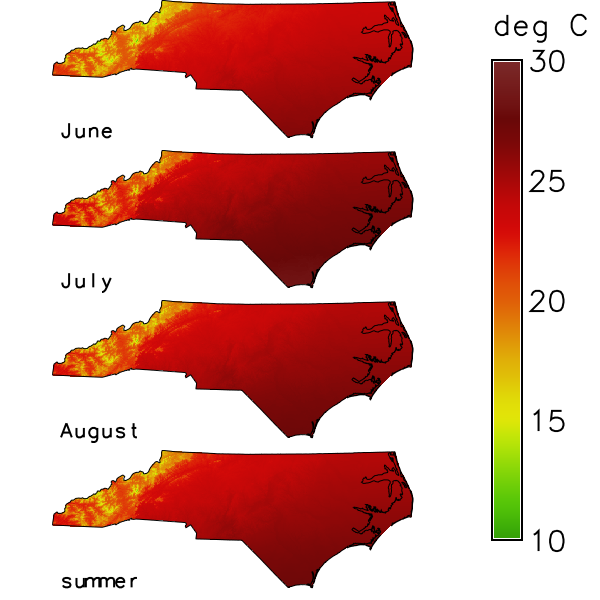

## DESCRIPTION

*t.rast.aggregate* aggregates the raster maps of a space time raster dataset
over regular periods of time, the granules, and registers the results as the
maps of a new space time raster dataset. A granule is a time interval of the
length **granularity**; the granules follow each other without a gap. Each new
map holds, for every cell, the result of an aggregation method over the input
maps that are related to its granule. Daily maps give monthly maps with
**granularity** `1 months`, for instance. The tool runs
*[r.series](r.series.md)* for every granule, so the methods and the results
are those of *r.series*. See the
[introduction to temporal data processing](temporalintro.md) for space time
datasets, and *[t.rast.aggregate.ds](t.rast.aggregate.ds.md)* for granules
that are given by the maps of another dataset.

The option **input** names the space time raster dataset; `input=name.label`
selects the maps of one semantic label. The option **output** names the new
space time raster dataset. It takes the temporal type, the semantic type, the
title and the description of the input dataset; its aggregation type is the
**method**. The option **where** takes an SQL condition on the registered maps
and selects the input maps, for instance by their `start_time`; without it,
all maps are used.

### Granules

The option **granularity** gives the length of a granule. In absolute time it
is one number and one unit, for instance `1 months` or `12 hours`; the units
are `seconds`, `minutes`, `hours`, `days`, `weeks`, `months` and `years`. A
form with several units, such as `1 months, 5 days`, is refused. In relative
time it is an integer, counted in the unit of the input dataset.

The first granule starts at the start of the first selected map, moved back to
the beginning of the unit of the granularity: a year to 1 January, a month to
the first of the month, a week to 00:00:00 on the Monday on or before the map,
which may lie in the month or the year before, a day to 00:00:00, an hour to
the full hour, a minute to the full minute. The fourth example shows this for
each unit. The grid ends
with the granule that holds the end of the last map, or the last map itself if
it is a time instant.

The option **sampling** is a list of temporal relations, `contains` by
default; it sets which maps belong to a granule. The relation is read from the
granule: with `contains`, a map lies within the granule; with `equal`, the map
has the start and the end of the granule; with `overlaps`, the granule starts
before the map starts and ends within the map. The other relations are
`overlapped`, `starts`, `started`, `finishes`, `finished` and `during`.
The name `related` stands for all nine of them, so a map belongs to every
granule with which it shares any time. `contains` already takes a map that
starts or ends with the granule; `related` adds the maps that cross a border of
the granule, the maps longer than the granule, and the map with the same start
and end.
Several relations are separated by commas; a map that fits two of them, for
instance `during` and `starts`, is aggregated once, and `related` together with
other names gives the same maps as `related` alone. The fifth example shows
`contains`, `overlaps`, `equal` and `related`.

### Aggregation

The option **method** is the aggregation of *r.series*: `average` (the
default), `count`, `median`, `mode`, `minimum`, `min_raster`, `maximum`,
`max_raster`, `stddev`, `range`, `sum`, `variance`, `diversity`, `slope`,
`offset`, `detcoeff`, `quart1`, `quart3`, `perc90`, `quantile`, `skewness` and
`kurtosis`. The maps of a granule are read in the order of their time, which
matters for `min_raster`, `max_raster`, `slope`, `offset` and `detcoeff`.
*r.series* skips null cells, so a cell is aggregated over the maps that have a
value there. The method `quantile` has no quantile option in this tool, so
*r.series* uses the quantile `0`, and the result is the smallest value.

The flag **-w** weights each map by the time it shares with the granule;
the tool hands the weights to *r.series* together with the maps. For
**method** `sum` the weight is the overlap divided by the length of the map:
a weekly sum that lies within the granule counts in full, one that lies half
in it counts half. For the other methods the weight is the overlap divided by
the length of the granule, and *r.series* divides the weighted sum by the
sum of the weights, so a map that covers more of the granule counts more. In
relative time the lengths are counted in the unit of the dataset. Only
**sampling** `related` (or a list with `overlaps`, `overlapped`, `starts`,
`finishes` and `during`) brings in the maps that reach over the border of a
granule; with the default `contains`, each map lies within its granule, so
`sum` gives the same values as without **-w**. The sixth example shows
`average` and `sum` with `related`.

With **-w**, the methods `minimum`, `maximum`, `range`, `min_raster`,
`max_raster` and `diversity` are refused, because *r.series* has no weighted
form of them. Refused as well are the methods whose weighted form in
*r.series* gives no meaningful result: `count` adds up the weights instead of
counting the maps; `slope`, `offset` and `detcoeff` give null cells, because
*r.series* counts the weights as whole numbers. A time instant has no length
to weight by, so a selected map that is a time instant is refused as well. A
map that only touches a granule would get the weight 0, and a granule whose
weights add up to 0 gives null cells, as *r.series* computes it; every
relation that **sampling** takes shares time with the granule, so each
related map has a weight above 0.

The flag **-n** registers the maps whose cells are all null. Without it, a
granule whose related maps hold only null cells gives no new map. A granule
without any related map gives no map in either case.

### Names of the new maps

The new maps are named after the option **basename**, followed by an
underscore and a suffix that the option **suffix** chooses:

- `gran` (the default) takes the start time of the granule, cut to the unit of
  the granularity: `2026` for years, `2026_01` for months, `2026_01_12` for
  days or weeks, `2026_01_14_12` for hours and `2026_01_14_12_30` for minutes;
- `time` takes the full start time, for instance `2026_01_01T00_00_00`;
- `num` takes the number of the granule, from 1, with five digits; `num%NN`
  takes NN digits, so `num%03` gives `001`.

The option **offset** is added to the number of `num`, `0` by default. A
granule without a related map gives no map, but its number is used, so a
numbered series can have a gap. In relative time, every suffix gives the
number, because a relative time has no calendar date.

### Computation

*r.series* keeps every map of a granule open once per thread and needs two
files per map and thread. The tool therefore runs *r.series* with the flag
**-z**, which reads the maps row by row, when the maps of a granule exceed
**file_limit** (`1000` by default) or when 2 x threads x maps + 64 exceeds the
limit of open files of the process (`ulimit -n`). The threads are counted from
`NPROCS` of the GRASS session (see *g.gisenv*), else `OMP_NUM_THREADS`, else
the usable processors. With a raster mask (see *r.mask*), *r.series* runs one
thread, and so does the count. In a GRASS built without OpenMP, *r.series*
runs one thread; the count does not know this and may set **-z** earlier than
needed. The tool warns whenever it sets the flag. Without a limit on open
files, or without the Python module `resource` (for example on Windows),
**file_limit** alone counts. The flag does not change the result but is
slower: for 100 maps of 1000 x 1000 cells, *r.series* took 5.2 s with **-z**
instead of 0.25 s (measured 31.10.2026 with method sum, three runs). The ninth
example sets a low **file_limit**.

The option **nprocs** sets how many granules are aggregated at the same time,
`1` by default; a value below `1` runs one process. The result does not depend
on **nprocs**.

## NOTES

The tool computes the new maps in the current computational region, as
*r.series* does; see *g.region*.

A granule with a single related map is copied as it is: the method does not
matter, and the value, the type of the map (`CELL` stays `CELL`) and its colour
table stay as they were. This holds with **-w** as well, except for
**method** `sum`: a single map whose weight is not 1 is scaled by
*r.series*, and the result is a `DCELL` map.

An existing **output** dataset is replaced only with **--overwrite**; without
it the tool refuses with one message. The tool stops before the computation if
the name of a new map equals the name of a map of the input dataset in the
current mapset.

A dot in the name of the new dataset is refused, for instance for
`output=my.out`, with the message "`<my.out>` is not a valid name for a new
space time dataset: a dot is not allowed".

The input dataset can be in another mapset of the project; the name with the
mapset (`input=temperature_monthly@t_rast_aggregate`) selects it, as the last
example shows. The new maps and the new dataset are always created in the
current mapset.

If no map is related to any granule, the tool warns, names the granularity and
the sampling, and creates no dataset; it ends without an error. With monthly
granules and maps that do not start on the first day of a month, for example a
series that starts on 31 January, the default sampling `contains` finds
nothing; `sampling=overlaps` relates each map to the granule in which it
starts and which it outlasts.

Wrong input stops the tool with a message before anything is written:

- An **input** dataset that does not exist: "Space time dataset `<name>` of
  type `<strds>` not found".
- A **where** that selects no map: "Space time raster dataset `<name>` is
  empty". An SQL error in **where** gives a message that begins with "Invalid
  where condition".
- An unknown **suffix**, for instance "Invalid suffix `<gram>`, use gran, time,
  num or num%NN" for `suffix=gram`.
- In absolute time, a **granularity** with another unit ("Wrong granularity
  format: 1 fortnight") or with a fraction ("Cannot read '1.5 days' as a time
  step"); without a unit, as in `2`, the message is "Invalid granularity
  `<2>`", and with several units, as in `1 months, 5 days`, it is "Invalid
  granularity `<1 months, 5 days>`".
- In relative time, a **granularity** that is not an integer ("Invalid
  granularity `<1.5>`") or not positive ("The granularity 0 must be
  positive").

With `granularity="7 days"`, the first granule starts at 00:00:00 on the day
of the first map, so the granules are not tied to Mondays; the fourth example
shows both.

## EXAMPLES

The examples run in the North Carolina sample dataset `nc_spm_08_grass7` from
the [GRASS sample data](https://grass.osgeo.org/download/data/). The first
example creates the mapset `t_rast_aggregate` and sets the computational
region to North Carolina with cells of 1 km; the later examples work in this
mapset and region, except the last, which creates a second mapset with the
same region. The examples that show how granules and sampling work use
maps with small constant values, so that the results can be checked by hand.

<!-- example-project: dataset=nc_spm_08_grass7 mapset=t_rast_aggregate -->

<!-- markdownlint-disable MD046 -->

### Aggregate monthly means to seasons

The dataset `temperature_monthly` holds twelve maps of the monthly mean air
temperature in 2020, in degrees Celsius rounded to tenths. They are generated
from the elevation model `elev_state_500m`: 16.5 degrees at sea level and the
northing 160 km, an annual cycle of plus and minus 10.5 degrees with its
maximum in July, 6.5 degrees less for every 1000 m of elevation, and 1 degree
more for every 100 km to the south. Each map is an interval of one month.

The **where** condition selects the maps from March to November, and
**granularity** `3 months` makes the granules March to May, June to August and
September to November: spring, summer and autumn. The first granule starts on
March 1, the start of the first selected map. **method** `average` gives, in
each cell, the mean of the three monthly maps of a season. The list shows the
new maps with their granules and their smallest and largest value. In summer
the warmest cell has 26.5, 28.4 and 27.6 degrees in June, July and August, so
its mean is 27.5 degrees. Autumn is warmer than spring, because the annual
cycle (`cos(30 * (month - 7.2))`) has its maximum a little after the July
map.

=== "Command line"

    ```sh
    g.mapset -c mapset=t_rast_aggregate
    g.region raster=elev_state_500m res=1000 -a
    for month in $(seq 12); do
        echo "temperature_monthly_2020_$(printf %02d $month) = round((16.5" \
            "+ 10.5 * cos(30 * ($month - 7.2)) - 0.0065 * elev_state_500m" \
            "- 0.00001 * (y() - 160000)) * 10) / 10.0"
    done | r.mapcalc file=-
    t.create output=temperature_monthly title="Air temperature" \
        description="Monthly mean air temperature 2020 in degree Celsius"
    t.register -i input=temperature_monthly \
        maps=$(g.list type=raster pattern="temperature_monthly_*" mapset=. separator=comma) \
        start=2020-01-01 increment="1 month"
    t.rast.aggregate input=temperature_monthly output=temperature_season \
        basename=temperature_season granularity="3 months" method=average \
        where="start_time >= '2020-03-01' and start_time < '2020-12-01'"
    t.rast.list input=temperature_season columns=name,start_time,end_time,min,max
    ```

    ```text
    name|start_time|end_time|min|max
    temperature_season_2020_03|2020-03-01 00:00:00|2020-06-01 00:00:00|2.466666666666667|16.966666666666665
    temperature_season_2020_06|2020-06-01 00:00:00|2020-09-01 00:00:00|13.0|27.5
    temperature_season_2020_09|2020-09-01 00:00:00|2020-12-01 00:00:00|4.466666666666666|19.0
    ```

=== "Python (grass.tools)"

    ```python
    from grass.tools import Tools

    tools = Tools()
    tools.g_mapset(flags="c", mapset="t_rast_aggregate")
    tools.g_region(raster="elev_state_500m", res=1000, flags="a")
    months = range(1, 13)
    tools.r_mapcalc(
        expression="\n".join(
            f"temperature_monthly_2020_{month:02d} = round((16.5"
            f" + 10.5 * cos(30 * ({month} - 7.2)) - 0.0065 * elev_state_500m"
            " - 0.00001 * (y() - 160000)) * 10) / 10.0"
            for month in months
        )
    )
    tools.t_create(
        output="temperature_monthly",
        title="Air temperature",
        description="Monthly mean air temperature 2020 in degree Celsius",
    )
    tools.t_register(
        input="temperature_monthly",
        maps=",".join(f"temperature_monthly_2020_{month:02d}" for month in months),
        start="2020-01-01",
        increment="1 month",
        flags="i",
    )
    tools.t_rast_aggregate(
        input="temperature_monthly",
        output="temperature_season",
        basename="temperature_season",
        granularity="3 months",
        method="average",
        where="start_time >= '2020-03-01' and start_time < '2020-12-01'",
    )
    columns = "name,start_time,end_time,min,max"
    print(tools.t_rast_list(input="temperature_season", columns=columns).text)
    ```

    ```text
    name|start_time|end_time|min|max
    temperature_season_2020_03|2020-03-01 00:00:00|2020-06-01 00:00:00|2.466666666666667|16.966666666666665
    temperature_season_2020_06|2020-06-01 00:00:00|2020-09-01 00:00:00|13.0|27.5
    temperature_season_2020_09|2020-09-01 00:00:00|2020-12-01 00:00:00|4.466666666666666|19.0
    ```

### Compare the maps before and after

The figure shows the three monthly maps of summer, June, July and August, and
below them their mean from the previous example, each with the border of North
Carolina from the vector map `nc_state`. *[t.rast.colors](t.rast.colors.md)*
gives the maps of both datasets the colour table `celsius`, which fixes a
colour for each temperature, so the same colour means the same temperature in
all four maps. *d.frame* makes one frame per map, *d.rast* draws the map,
*d.vect* the border and *d.text* the name; *d.legend* draws the legend in a
frame of its own.

=== "Command line"

    ```sh
    t.rast.colors input=temperature_monthly color=celsius
    t.rast.colors input=temperature_season color=celsius
    d.mon start=cairo output=t_rast_aggregate_summer.png width=600 height=600
    row=0
    for map in "temperature_monthly_2020_06 June" \
        "temperature_monthly_2020_07 July" \
        "temperature_monthly_2020_08 August" \
        "temperature_season_2020_06 summer"; do
        set -- $map
        top=$((100 - 25 * row))
        d.frame -c frame=map_$row at=$((top - 25)),$top,0,80
        d.rast map=$1
        d.vect map=nc_state type=boundary color=black
        d.text text=$2 at=2,8 size=14 color=black
        row=$((row + 1))
    done
    d.frame -c frame=legend at=0,100,80,100
    d.legend raster=temperature_season_2020_06 range=10,30 at=10,90,10,35 \
        label_step=5 digits=0 title="deg C"
    d.mon stop=cairo
    ```

=== "Python (grass.tools)"

    ```python
    tools.t_rast_colors(input="temperature_monthly", color="celsius")
    tools.t_rast_colors(input="temperature_season", color="celsius")
    tools.d_mon(start="cairo", output="t_rast_aggregate_summer.png", width=600, height=600)
    for row, (name, label) in enumerate(
        (
            ("temperature_monthly_2020_06", "June"),
            ("temperature_monthly_2020_07", "July"),
            ("temperature_monthly_2020_08", "August"),
            ("temperature_season_2020_06", "summer"),
        )
    ):
        top = 100 - 25 * row
        tools.d_frame(flags="c", frame=f"map_{row}", at=[top - 25, top, 0, 80])
        tools.d_rast(map=name)
        tools.d_vect(map="nc_state", type="boundary", color="black")
        tools.d_text(text=label, at=[2, 8], size=14, color="black")
    tools.d_frame(flags="c", frame="legend", at=[0, 100, 80, 100])
    tools.d_legend(
        raster="temperature_season_2020_06",
        range=[10, 30],
        at=[10, 90, 10, 35],
        label_step=5,
        digits=0,
        title="deg C",
    )
    tools.d_mon(stop="cairo")
    ```



*Figure: Generated mean air temperature of June, July and August 2020 and, at the
bottom, their mean for the summer.*

### Choose the method and the names of the new maps

Three more aggregations, each with a different **method**, a different
**suffix** and, in the second block, an **offset**. The output lists the new
maps with their granules and their smallest and largest value.

1. **method** `maximum` with **suffix** `time` gives, in each cell, the
   temperature of the warmest month of each season and names the maps with
   the full start time. In summer, this is July: 13.9 to 28.4 degrees.
2. **method** `minimum` with **suffix** `num%03` and **offset** `10` gives the
   temperature of the coldest month and numbers the maps with three digits,
   counting from 1 plus the offset: 11, 12 and 13. In spring, this is March,
   in autumn November.
3. The third block creates the dataset `precipitation_monthly`, monthly
   precipitation sums in whole millimeters that are generated from the 30-year
   normals, not measured: the monthly normal of the climate stations of
   `precip_30ynormals` (the columns `jan` to `dec`), interpolated with
   *v.surf.idw*, times an assumed factor for each month of a wet year 2020.
   **granularity** `2 months` with **method** `sum` gives the precipitation of
   January and February, March and April, and so on. The monthly sums are
   whole numbers, and so are their sums, so the statistics of
   *[t.rast.univar](t.rast.univar.md)* do not depend on the order in which the
   cells are added up; the block shows the smallest, the largest and the mean
   value of each new map.

=== "Command line"

    ```sh
    t.rast.aggregate input=temperature_monthly output=temperature_warmest \
        basename=temperature_warmest granularity="3 months" method=maximum \
        suffix=time where="start_time >= '2020-03-01' and start_time < '2020-12-01'"
    t.rast.list input=temperature_warmest columns=name,start_time,min,max
    ```

    ```text
    name|start_time|min|max
    temperature_warmest_2020_03_01T00_00_00|2020-03-01 00:00:00|7.7|22.2
    temperature_warmest_2020_06_01T00_00_00|2020-06-01 00:00:00|13.9|28.4
    temperature_warmest_2020_09_01T00_00_00|2020-09-01 00:00:00|9.6|24.2
    ```

    ```sh
    t.rast.aggregate input=temperature_monthly output=temperature_coldest \
        basename=temperature_coldest granularity="3 months" method=minimum \
        suffix=num%03 offset=10 \
        where="start_time >= '2020-03-01' and start_time < '2020-12-01'"
    t.rast.list input=temperature_coldest columns=name,start_time,min,max
    ```

    ```text
    name|start_time|min|max
    temperature_coldest_011|2020-03-01 00:00:00|-2.7|11.8
    temperature_coldest_012|2020-06-01 00:00:00|12.0|26.5
    temperature_coldest_013|2020-09-01 00:00:00|-0.8|13.7
    ```

    ```sh
    month=1
    for entry in jan:1.2 feb:1.7 mar:0.9 apr:1.3 may:1.6 jun:0.9 \
        jul:1.1 aug:1.5 sep:0.8 oct:1.0 nov:1.6 dec:0.9; do
        name=$(printf %02d $month)
        v.surf.idw input=precip_30ynormals column=${entry%:*} \
            output=precipitation_normal_$name npoints=12 power=2
        r.mapcalc expression="precipitation_monthly_2020_$name = if(isnull(elev_state_500m), null(), round(${entry#*:} * precipitation_normal_$name))"
        month=$((month + 1))
    done
    t.create output=precipitation_monthly title="Precipitation" \
        description="Monthly precipitation sum 2020 in mm"
    t.register -i input=precipitation_monthly \
        maps=$(g.list type=raster pattern="precipitation_monthly_*" mapset=. separator=comma) \
        start=2020-01-01 increment="1 month"
    t.rast.aggregate input=precipitation_monthly output=precipitation_bimonthly \
        basename=precipitation_bimonthly granularity="2 months" method=sum
    t.rast.univar input=precipitation_bimonthly | cut -d"|" -f1,7,8,10
    ```

    ```text
    id|min|max|mean
    precipitation_bimonthly_2020_01@t_rast_aggregate|232|558|296.33885217799
    precipitation_bimonthly_2020_03@t_rast_aggregate|184|443|220.397210297285
    precipitation_bimonthly_2020_05@t_rast_aggregate|217|501|273.625771050974
    precipitation_bimonthly_2020_07@t_rast_aggregate|210|514|330.528944630848
    precipitation_bimonthly_2020_09@t_rast_aggregate|120|303|188.309797658642
    precipitation_bimonthly_2020_11@t_rast_aggregate|174|518|219.85562848896
    ```

=== "Python (grass.tools)"

    ```python
    seasons = "start_time >= '2020-03-01' and start_time < '2020-12-01'"
    tools.t_rast_aggregate(
        input="temperature_monthly",
        output="temperature_warmest",
        basename="temperature_warmest",
        granularity="3 months",
        method="maximum",
        suffix="time",
        where=seasons,
    )
    columns = "name,start_time,min,max"
    print(tools.t_rast_list(input="temperature_warmest", columns=columns).text)
    ```

    ```text
    name|start_time|min|max
    temperature_warmest_2020_03_01T00_00_00|2020-03-01 00:00:00|7.7|22.2
    temperature_warmest_2020_06_01T00_00_00|2020-06-01 00:00:00|13.9|28.4
    temperature_warmest_2020_09_01T00_00_00|2020-09-01 00:00:00|9.6|24.2
    ```

    ```python
    tools.t_rast_aggregate(
        input="temperature_monthly",
        output="temperature_coldest",
        basename="temperature_coldest",
        granularity="3 months",
        method="minimum",
        suffix="num%03",
        offset=10,
        where=seasons,
    )
    print(tools.t_rast_list(input="temperature_coldest", columns=columns).text)
    ```

    ```text
    name|start_time|min|max
    temperature_coldest_011|2020-03-01 00:00:00|-2.7|11.8
    temperature_coldest_012|2020-06-01 00:00:00|12.0|26.5
    temperature_coldest_013|2020-09-01 00:00:00|-0.8|13.7
    ```

    ```python
    factors = {"jan": 1.2, "feb": 1.7, "mar": 0.9, "apr": 1.3, "may": 1.6, "jun": 0.9}
    factors |= {"jul": 1.1, "aug": 1.5, "sep": 0.8, "oct": 1.0, "nov": 1.6, "dec": 0.9}
    for month, (column, factor) in enumerate(factors.items(), start=1):
        normal = f"precipitation_normal_{month:02d}"
        tools.v_surf_idw(
            input="precip_30ynormals", column=column, output=normal, npoints=12, power=2
        )
        tools.r_mapcalc(
            expression=f"precipitation_monthly_2020_{month:02d} ="
            f" if(isnull(elev_state_500m), null(), round({factor} * {normal}))"
        )
    tools.t_create(
        output="precipitation_monthly",
        title="Precipitation",
        description="Monthly precipitation sum 2020 in mm",
    )
    tools.t_register(
        input="precipitation_monthly",
        maps=",".join(f"precipitation_monthly_2020_{month:02d}" for month in months),
        start="2020-01-01",
        increment="1 month",
        flags="i",
    )
    tools.t_rast_aggregate(
        input="precipitation_monthly",
        output="precipitation_bimonthly",
        basename="precipitation_bimonthly",
        granularity="2 months",
        method="sum",
    )
    for line in tools.t_rast_univar(input="precipitation_bimonthly").text.splitlines():
        fields = line.split("|")
        print("|".join(fields[index] for index in (0, 6, 7, 9)))
    ```

    ```text
    id|min|max|mean
    precipitation_bimonthly_2020_01@t_rast_aggregate|232|558|296.33885217799
    precipitation_bimonthly_2020_03@t_rast_aggregate|184|443|220.397210297285
    precipitation_bimonthly_2020_05@t_rast_aggregate|217|501|273.625771050974
    precipitation_bimonthly_2020_07@t_rast_aggregate|210|514|330.528944630848
    precipitation_bimonthly_2020_09@t_rast_aggregate|120|303|188.309797658642
    precipitation_bimonthly_2020_11@t_rast_aggregate|174|518|219.85562848896
    ```

### Where the first granule starts

The dataset `gusts` holds three readings of the wind gust speed, 1, 2 and 3
m/s in every cell, as time instants on 14 January 2026, a Wednesday, at
12:30:45, 12:31:10 and 12:31:35. The first two blocks aggregate it with six
granularities, from years to minutes, and list the new maps of each. The
first granule starts at the beginning of the unit of the granularity:
`2026-01-01` for years, `2026-01-01` for months, `2026-01-12` (the Monday) for
weeks, `2026-01-14` for days, `12:00:00` for hours and `12:30:00` for minutes.
With minutes, the first instant (12:30:45) lies in the granule from 12:30 and
the other two (12:31:10 and 12:31:35) in the granule from 12:31, so there are
two granules. **method** `maximum` gives the strongest gust of each granule.

The third block shows a week that begins in the year before. The dataset
`frost` holds one map of a night frost at 3 January 2026, a Saturday. The week
granule starts on the Monday before, 29 December 2025, and holds the map; with
`7 days`, the granule starts on the day of the map.

=== "Command line"

    ```sh
    r.mapcalc expression="gust_1 = 1"
    r.mapcalc expression="gust_2 = 2"
    r.mapcalc expression="gust_3 = 3"
    t.create output=gusts title="Wind gusts" \
        description="Wind gust speed in m/s at three instants"
    t.register input=gusts maps=gust_1,gust_2,gust_3 \
        start="2026-01-14 12:30:45" increment="25 seconds"
    for unit in years months weeks; do
        t.rast.aggregate input=gusts output=gusts_$unit basename=gusts_$unit \
            granularity="1 $unit" method=maximum
        t.rast.list input=gusts_$unit columns=name,start_time,end_time
    done
    ```

    ```text
    name|start_time|end_time
    gusts_years_2026|2026-01-01 00:00:00|2027-01-01 00:00:00
    name|start_time|end_time
    gusts_months_2026_01|2026-01-01 00:00:00|2026-02-01 00:00:00
    name|start_time|end_time
    gusts_weeks_2026_01_12|2026-01-12 00:00:00|2026-01-19 00:00:00
    ```

    ```sh
    for unit in days hours minutes; do
        t.rast.aggregate input=gusts output=gusts_$unit basename=gusts_$unit \
            granularity="1 $unit" method=maximum
        t.rast.list input=gusts_$unit columns=name,start_time,end_time
    done
    ```

    ```text
    name|start_time|end_time
    gusts_days_2026_01_14|2026-01-14 00:00:00|2026-01-15 00:00:00
    name|start_time|end_time
    gusts_hours_2026_01_14_12|2026-01-14 12:00:00|2026-01-14 13:00:00
    name|start_time|end_time
    gusts_minutes_2026_01_14_12_30|2026-01-14 12:30:00|2026-01-14 12:31:00
    gusts_minutes_2026_01_14_12_31|2026-01-14 12:31:00|2026-01-14 12:32:00
    ```

    ```sh
    r.mapcalc expression="frost_1 = 1"
    t.create output=frost title="Frost" description="One night frost in a first week"
    t.register input=frost maps=frost_1 start=2026-01-03
    t.rast.aggregate input=frost output=frost_weeks basename=frost_weeks \
        granularity="1 weeks" method=sum
    t.rast.list input=frost_weeks columns=name,start_time,end_time
    t.rast.aggregate input=frost output=frost_days basename=frost_days \
        granularity="7 days" method=sum
    t.rast.list input=frost_days columns=name,start_time,end_time
    ```

    ```text
    name|start_time|end_time
    frost_weeks_2025_12_29|2025-12-29 00:00:00|2026-01-05 00:00:00
    name|start_time|end_time
    frost_days_2026_01_03|2026-01-03 00:00:00|2026-01-10 00:00:00
    ```

=== "Python (grass.tools)"

    ```python
    for number in (1, 2, 3):
        tools.r_mapcalc(expression=f"gust_{number} = {number}")
    tools.t_create(
        output="gusts",
        title="Wind gusts",
        description="Wind gust speed in m/s at three instants",
    )
    tools.t_register(
        input="gusts",
        maps="gust_1,gust_2,gust_3",
        start="2026-01-14 12:30:45",
        increment="25 seconds",
    )
    for unit in ("years", "months", "weeks"):
        tools.t_rast_aggregate(
            input="gusts",
            output=f"gusts_{unit}",
            basename=f"gusts_{unit}",
            granularity=f"1 {unit}",
            method="maximum",
        )
        print(
            tools.t_rast_list(
                input=f"gusts_{unit}", columns="name,start_time,end_time"
            ).text
        )
    ```

    ```text
    name|start_time|end_time
    gusts_years_2026|2026-01-01 00:00:00|2027-01-01 00:00:00
    name|start_time|end_time
    gusts_months_2026_01|2026-01-01 00:00:00|2026-02-01 00:00:00
    name|start_time|end_time
    gusts_weeks_2026_01_12|2026-01-12 00:00:00|2026-01-19 00:00:00
    ```

    ```python
    for unit in ("days", "hours", "minutes"):
        tools.t_rast_aggregate(
            input="gusts",
            output=f"gusts_{unit}",
            basename=f"gusts_{unit}",
            granularity=f"1 {unit}",
            method="maximum",
        )
        print(
            tools.t_rast_list(
                input=f"gusts_{unit}", columns="name,start_time,end_time"
            ).text
        )
    ```

    ```text
    name|start_time|end_time
    gusts_days_2026_01_14|2026-01-14 00:00:00|2026-01-15 00:00:00
    name|start_time|end_time
    gusts_hours_2026_01_14_12|2026-01-14 12:00:00|2026-01-14 13:00:00
    name|start_time|end_time
    gusts_minutes_2026_01_14_12_30|2026-01-14 12:30:00|2026-01-14 12:31:00
    gusts_minutes_2026_01_14_12_31|2026-01-14 12:31:00|2026-01-14 12:32:00
    ```

    ```python
    tools.r_mapcalc(expression="frost_1 = 1")
    tools.t_create(
        output="frost", title="Frost", description="One night frost in a first week"
    )
    tools.t_register(input="frost", maps="frost_1", start="2026-01-03")
    tools.t_rast_aggregate(
        input="frost",
        output="frost_weeks",
        basename="frost_weeks",
        granularity="1 weeks",
        method="sum",
    )
    print(tools.t_rast_list(input="frost_weeks", columns="name,start_time,end_time").text)
    tools.t_rast_aggregate(
        input="frost",
        output="frost_days",
        basename="frost_days",
        granularity="7 days",
        method="sum",
    )
    print(tools.t_rast_list(input="frost_days", columns="name,start_time,end_time").text)
    ```

    ```text
    name|start_time|end_time
    frost_weeks_2025_12_29|2025-12-29 00:00:00|2026-01-05 00:00:00
    name|start_time|end_time
    frost_days_2026_01_03|2026-01-03 00:00:00|2026-01-10 00:00:00
    ```

### Choose the maps of a granule

The dataset `dekads` holds four sums of precipitation over ten days,
`rain_dekad_1` to `rain_dekad_4`, with 1 to 4 mm in every cell. The maps
follow each other: `rain_dekad_1` runs from 21 to 31 January, `rain_dekad_2`
from 31 January to 10 February, `rain_dekad_3` from 10 to 20 February and
`rain_dekad_4` from 20 February to 2 March. Two maps cross the border of a
month.

With the default **sampling** `contains` and monthly granules, only
`rain_dekad_1` lies within January and only `rain_dekad_3` within February:
each granule has a single map and copies it, so the new maps hold 1 and 3.
With `contains,overlaps`, the granule January also takes `rain_dekad_2`,
because the granule starts before the map and ends within it, and the granule
February takes `rain_dekad_4`; the sums are 1 + 2 = 3 and 3 + 4 = 7. The third
block adds **where**, which leaves out the maps that start before February:
only `rain_dekad_3` and `rain_dekad_4` are left, and the first granule starts
on 1 February, the beginning of the month of `rain_dekad_3`. The fourth block
aggregates the seasonal means of the first example: each has the start and the
end of a granule of `3 months`, so **sampling** `equal` relates it to that
granule, and the granule copies it. The fifth block uses `related`, which takes
every map that shares time with a granule. January gets `rain_dekad_1` and
`rain_dekad_2`, the sum is 1 + 2 = 3. February gets `rain_dekad_2`,
`rain_dekad_3` and `rain_dekad_4`, the sum is 2 + 3 + 4 = 9, and `rain_dekad_4`
also reaches into March, which gets that map alone, so its sum is 4. A map that
crosses a border is thus counted in both granules; the sums add up to more than
the total of the maps.

=== "Command line"

    ```sh
    for number in 1 2 3 4; do
        r.mapcalc expression="rain_dekad_$number = $number"
    done
    t.create output=dekads title="Precipitation" \
        description="Precipitation sum in mm over ten days"
    t.register input=dekads maps=rain_dekad_1 start=2026-01-21 end=2026-01-31
    t.register input=dekads maps=rain_dekad_2 start=2026-01-31 end=2026-02-10
    t.register input=dekads maps=rain_dekad_3 start=2026-02-10 end=2026-02-20
    t.register input=dekads maps=rain_dekad_4 start=2026-02-20 end=2026-03-02
    t.rast.aggregate input=dekads output=rain_contained basename=rain_contained \
        granularity="1 months" method=sum
    t.rast.list input=rain_contained columns=name,start_time,min,max
    ```

    ```text
    name|start_time|min|max
    rain_contained_2026_01|2026-01-01 00:00:00|1.0|1.0
    rain_contained_2026_02|2026-02-01 00:00:00|3.0|3.0
    ```

    ```sh
    t.rast.aggregate input=dekads output=rain_touched basename=rain_touched \
        granularity="1 months" method=sum sampling=contains,overlaps
    t.rast.list input=rain_touched columns=name,start_time,min,max
    ```

    ```text
    name|start_time|min|max
    rain_touched_2026_01|2026-01-01 00:00:00|3.0|3.0
    rain_touched_2026_02|2026-02-01 00:00:00|7.0|7.0
    ```

    ```sh
    t.rast.aggregate input=dekads output=rain_february basename=rain_february \
        granularity="1 months" method=sum sampling=contains,overlaps \
        where="start_time >= '2026-02-01'"
    t.rast.list input=rain_february columns=name,start_time,min,max
    ```

    ```text
    name|start_time|min|max
    rain_february_2026_02|2026-02-01 00:00:00|7.0|7.0
    ```

    ```sh
    t.rast.aggregate input=temperature_season output=temperature_copied \
        basename=temperature_copied granularity="3 months" sampling=equal
    t.rast.list input=temperature_copied columns=name,start_time,min,max
    ```

    ```text
    name|start_time|min|max
    temperature_copied_2020_03|2020-03-01 00:00:00|2.466666666666667|16.966666666666665
    temperature_copied_2020_06|2020-06-01 00:00:00|13.0|27.5
    temperature_copied_2020_09|2020-09-01 00:00:00|4.466666666666666|19.0
    ```

    ```sh
    t.rast.aggregate input=dekads output=rain_related basename=rain_related \
        granularity="1 months" method=sum sampling=related
    t.rast.list input=rain_related columns=name,start_time,min,max
    ```

    ```text
    name|start_time|min|max
    rain_related_2026_01|2026-01-01 00:00:00|3.0|3.0
    rain_related_2026_02|2026-02-01 00:00:00|9.0|9.0
    rain_related_2026_03|2026-03-01 00:00:00|4.0|4.0
    ```

=== "Python (grass.tools)"

    ```python
    for number in (1, 2, 3, 4):
        tools.r_mapcalc(expression=f"rain_dekad_{number} = {number}")
    tools.t_create(
        output="dekads",
        title="Precipitation",
        description="Precipitation sum in mm over ten days",
    )
    for number, start, end in (
        (1, "2026-01-21", "2026-01-31"),
        (2, "2026-01-31", "2026-02-10"),
        (3, "2026-02-10", "2026-02-20"),
        (4, "2026-02-20", "2026-03-02"),
    ):
        tools.t_register(input="dekads", maps=f"rain_dekad_{number}", start=start, end=end)
    tools.t_rast_aggregate(
        input="dekads",
        output="rain_contained",
        basename="rain_contained",
        granularity="1 months",
        method="sum",
    )
    print(tools.t_rast_list(input="rain_contained", columns=columns).text)
    ```

    ```text
    name|start_time|min|max
    rain_contained_2026_01|2026-01-01 00:00:00|1.0|1.0
    rain_contained_2026_02|2026-02-01 00:00:00|3.0|3.0
    ```

    ```python
    tools.t_rast_aggregate(
        input="dekads",
        output="rain_touched",
        basename="rain_touched",
        granularity="1 months",
        method="sum",
        sampling="contains,overlaps",
    )
    print(tools.t_rast_list(input="rain_touched", columns=columns).text)
    ```

    ```text
    name|start_time|min|max
    rain_touched_2026_01|2026-01-01 00:00:00|3.0|3.0
    rain_touched_2026_02|2026-02-01 00:00:00|7.0|7.0
    ```

    ```python
    tools.t_rast_aggregate(
        input="dekads",
        output="rain_february",
        basename="rain_february",
        granularity="1 months",
        method="sum",
        sampling="contains,overlaps",
        where="start_time >= '2026-02-01'",
    )
    print(tools.t_rast_list(input="rain_february", columns=columns).text)
    ```

    ```text
    name|start_time|min|max
    rain_february_2026_02|2026-02-01 00:00:00|7.0|7.0
    ```

    ```python
    tools.t_rast_aggregate(
        input="temperature_season",
        output="temperature_copied",
        basename="temperature_copied",
        granularity="3 months",
        sampling="equal",
    )
    print(tools.t_rast_list(input="temperature_copied", columns=columns).text)
    ```

    ```text
    name|start_time|min|max
    temperature_copied_2020_03|2020-03-01 00:00:00|2.466666666666667|16.966666666666665
    temperature_copied_2020_06|2020-06-01 00:00:00|13.0|27.5
    temperature_copied_2020_09|2020-09-01 00:00:00|4.466666666666666|19.0
    ```

    ```python
    tools.t_rast_aggregate(
        input="dekads",
        output="rain_related",
        basename="rain_related",
        granularity="1 months",
        method="sum",
        sampling="related",
    )
    print(tools.t_rast_list(input="rain_related", columns=columns).text)
    ```

    ```text
    name|start_time|min|max
    rain_related_2026_01|2026-01-01 00:00:00|3.0|3.0
    rain_related_2026_02|2026-02-01 00:00:00|9.0|9.0
    rain_related_2026_03|2026-03-01 00:00:00|4.0|4.0
    ```

### Weight the maps by their share of a granule

The dataset `weeks` holds three weekly sums of precipitation,
`rain_week_1` to `rain_week_3`, with 7, 14 and 21 mm in every cell. They run
from 1 to 8 January, from 8 to 15 January and from 15 to 22 January. With
**granularity** `10 days` the granules are 1 to 11 January, 11 to 21 January
and 21 to 31 January, so the second and the third week cross the border of a
granule. **sampling** `related` relates each week to every granule with
which it shares time, and **-w** weights it by the days it has in the
granule.

The first block computes the average. Its weight is the share of the granule:
in the first granule `rain_week_1` has 7 of the 10 days and `rain_week_2` has
3, so the average is (7 x 7 + 3 x 14) / 10 = 9.1 mm. The second granule holds
4 days of `rain_week_2` and 6 of `rain_week_3`: (4 x 14 + 6 x 21) / 10 =
18.2 mm. The third granule holds only one day of `rain_week_3`; a single map
is copied, so the average is 21 mm. The second block computes the
sum. Its weight is the share of the week: the first granule takes all of
`rain_week_1` and 3/7 of `rain_week_2`, 7 + 6 = 13 mm; the second takes 4/7
of `rain_week_2` and 6/7 of `rain_week_3`, 8 + 18 = 26 mm; the third takes
1/7 of `rain_week_3`, 3 mm. Each week is thus split among the granules, and
the three sums add up to the 42 mm of the three weeks.

=== "Command line"

    ```sh
    for number in 1 2 3; do
        r.mapcalc expression="rain_week_$number = 7 * $number"
    done
    t.create output=weeks title="Precipitation" \
        description="Precipitation sum in mm over a week"
    t.register input=weeks maps=rain_week_1,rain_week_2,rain_week_3 \
        start=2026-01-01 increment="7 days" -i
    t.rast.aggregate -w input=weeks output=rain_weighted_mean \
        basename=rain_weighted_mean granularity="10 days" method=average \
        sampling=related
    t.rast.list input=rain_weighted_mean columns=name,start_time,end_time,min,max
    ```

    ```text
    name|start_time|end_time|min|max
    rain_weighted_mean_2026_01_01|2026-01-01 00:00:00|2026-01-11 00:00:00|9.1|9.1
    rain_weighted_mean_2026_01_11|2026-01-11 00:00:00|2026-01-21 00:00:00|18.2|18.2
    rain_weighted_mean_2026_01_21|2026-01-21 00:00:00|2026-01-31 00:00:00|21.0|21.0
    ```

    ```sh
    t.rast.aggregate -w input=weeks output=rain_weighted_sum \
        basename=rain_weighted_sum granularity="10 days" method=sum \
        sampling=related
    t.rast.list input=rain_weighted_sum columns=name,start_time,end_time,min,max
    ```

    ```text
    name|start_time|end_time|min|max
    rain_weighted_sum_2026_01_01|2026-01-01 00:00:00|2026-01-11 00:00:00|13.0|13.0
    rain_weighted_sum_2026_01_11|2026-01-11 00:00:00|2026-01-21 00:00:00|26.0|26.0
    rain_weighted_sum_2026_01_21|2026-01-21 00:00:00|2026-01-31 00:00:00|3.0|3.0
    ```

=== "Python (grass.tools)"

    ```python
    for number in (1, 2, 3):
        tools.r_mapcalc(expression=f"rain_week_{number} = 7 * {number}")
    tools.t_create(
        output="weeks",
        title="Precipitation",
        description="Precipitation sum in mm over a week",
    )
    tools.t_register(
        input="weeks",
        maps="rain_week_1,rain_week_2,rain_week_3",
        start="2026-01-01",
        increment="7 days",
        flags="i",
    )
    tools.t_rast_aggregate(
        input="weeks",
        output="rain_weighted_mean",
        basename="rain_weighted_mean",
        granularity="10 days",
        method="average",
        sampling="related",
        flags="w",
    )
    granule_columns = "name,start_time,end_time,min,max"
    print(tools.t_rast_list(input="rain_weighted_mean", columns=granule_columns).text)
    ```

    ```text
    name|start_time|end_time|min|max
    rain_weighted_mean_2026_01_01|2026-01-01 00:00:00|2026-01-11 00:00:00|9.1|9.1
    rain_weighted_mean_2026_01_11|2026-01-11 00:00:00|2026-01-21 00:00:00|18.2|18.2
    rain_weighted_mean_2026_01_21|2026-01-21 00:00:00|2026-01-31 00:00:00|21.0|21.0
    ```

    ```python
    tools.t_rast_aggregate(
        input="weeks",
        output="rain_weighted_sum",
        basename="rain_weighted_sum",
        granularity="10 days",
        method="sum",
        sampling="related",
        flags="w",
    )
    print(tools.t_rast_list(input="rain_weighted_sum", columns=granule_columns).text)
    ```

    ```text
    name|start_time|end_time|min|max
    rain_weighted_sum_2026_01_01|2026-01-01 00:00:00|2026-01-11 00:00:00|13.0|13.0
    rain_weighted_sum_2026_01_11|2026-01-11 00:00:00|2026-01-21 00:00:00|26.0|26.0
    rain_weighted_sum_2026_01_21|2026-01-21 00:00:00|2026-01-31 00:00:00|3.0|3.0
    ```

### Null cells and empty granules

The dataset `radar` holds five maps of daily precipitation from a weather
radar. In January, `radar_1` has 4 mm in every cell and `radar_2` has 6 mm,
except west of the easting 500 km, where the radar failed and the cells are
null. In February the radar failed on both days: `radar_3` and `radar_4` have
only null cells. March has `radar_5` with 5 mm. The January average skips the
null cells: west of 500 km it holds 4 mm, taken from `radar_1` alone, and east
of it (4 + 6) / 2 = 5 mm, so the smallest value is 4 and the largest 5.

Without **-n**, February gives no map, because all its cells are null, so the
dataset has two maps. The second block aggregates again with **-n**; the
**--overwrite** replaces the dataset of the first block and its maps. February
is now registered, and its map has no smallest and no largest value, which the
list shows as `None`.

=== "Command line"

    ```sh
    r.mapcalc expression="radar_1 = 4"
    r.mapcalc expression="radar_2 = if(x() < 500000, null(), 6)"
    r.mapcalc expression="radar_3 = null()"
    r.mapcalc expression="radar_4 = null()"
    r.mapcalc expression="radar_5 = 5"
    t.create output=radar title="Precipitation" \
        description="Daily precipitation in mm from a weather radar"
    t.register input=radar maps=radar_1,radar_2 start=2026-01-01 increment="10 days"
    t.register input=radar maps=radar_3,radar_4 start=2026-02-01 increment="10 days"
    t.register input=radar maps=radar_5 start=2026-03-01
    t.rast.aggregate input=radar output=radar_monthly basename=radar \
        granularity="1 months" method=average
    t.rast.list input=radar_monthly columns=name,start_time,min,max
    ```

    ```text
    name|start_time|min|max
    radar_2026_01|2026-01-01 00:00:00|4.0|5.0
    radar_2026_03|2026-03-01 00:00:00|5.0|5.0
    ```

    ```sh
    t.rast.aggregate -n input=radar output=radar_monthly basename=radar \
        granularity="1 months" method=average --overwrite
    t.rast.list input=radar_monthly columns=name,start_time,min,max
    ```

    ```text
    name|start_time|min|max
    radar_2026_01|2026-01-01 00:00:00|4.0|5.0
    radar_2026_02|2026-02-01 00:00:00|None|None
    radar_2026_03|2026-03-01 00:00:00|5.0|5.0
    ```

=== "Python (grass.tools)"

    ```python
    tools.r_mapcalc(expression="radar_1 = 4")
    tools.r_mapcalc(expression="radar_2 = if(x() < 500000, null(), 6)")
    tools.r_mapcalc(expression="radar_3 = null()")
    tools.r_mapcalc(expression="radar_4 = null()")
    tools.r_mapcalc(expression="radar_5 = 5")
    tools.t_create(
        output="radar",
        title="Precipitation",
        description="Daily precipitation in mm from a weather radar",
    )
    for maps, start in (
        ("radar_1,radar_2", "2026-01-01"),
        ("radar_3,radar_4", "2026-02-01"),
    ):
        tools.t_register(input="radar", maps=maps, start=start, increment="10 days")
    tools.t_register(input="radar", maps="radar_5", start="2026-03-01")
    tools.t_rast_aggregate(
        input="radar",
        output="radar_monthly",
        basename="radar",
        granularity="1 months",
        method="average",
    )
    print(tools.t_rast_list(input="radar_monthly", columns=columns).text)
    ```

    ```text
    name|start_time|min|max
    radar_2026_01|2026-01-01 00:00:00|4.0|5.0
    radar_2026_03|2026-03-01 00:00:00|5.0|5.0
    ```

    ```python
    tools.t_rast_aggregate(
        input="radar",
        output="radar_monthly",
        basename="radar",
        granularity="1 months",
        method="average",
        flags="n",
        overwrite=True,
    )
    print(tools.t_rast_list(input="radar_monthly", columns=columns).text)
    ```

    ```text
    name|start_time|min|max
    radar_2026_01|2026-01-01 00:00:00|4.0|5.0
    radar_2026_02|2026-02-01 00:00:00|None|None
    radar_2026_03|2026-03-01 00:00:00|5.0|5.0
    ```

### Aggregate relative time

The dataset `runoff` holds the simulated runoff of a model, four maps
`runoff_1` to `runoff_4` with 1 to 4 mm, one for each hour, from 0 to 4. With
the integer **granularity** `2`, the granules are two hours long, in the unit of
the dataset, and the sums are 1 + 2 = 3 and 3 + 4 = 7. In relative time every
**suffix** gives the number of the granule, so the new maps are numbered with
five digits.

=== "Command line"

    ```sh
    for number in 1 2 3 4; do
        r.mapcalc expression="runoff_$number = $number"
    done
    t.create output=runoff temporaltype=relative title="Runoff" \
        description="Simulated runoff in mm per model hour"
    t.register -i input=runoff maps=runoff_1,runoff_2,runoff_3,runoff_4 \
        start=0 increment=1 unit=hours
    t.rast.aggregate input=runoff output=runoff_2h basename=runoff_2h \
        granularity=2 method=sum
    t.rast.list input=runoff_2h columns=name,start_time,end_time,min,max
    ```

    ```text
    name|start_time|end_time|min|max
    runoff_2h_00001|0|2|3.0|3.0
    runoff_2h_00002|2|4|7.0|7.0
    ```

=== "Python (grass.tools)"

    ```python
    for number in (1, 2, 3, 4):
        tools.r_mapcalc(expression=f"runoff_{number} = {number}")
    tools.t_create(
        output="runoff",
        temporaltype="relative",
        title="Runoff",
        description="Simulated runoff in mm per model hour",
    )
    tools.t_register(
        input="runoff",
        maps="runoff_1,runoff_2,runoff_3,runoff_4",
        start=0,
        increment=1,
        unit="hours",
        flags="i",
    )
    tools.t_rast_aggregate(
        input="runoff",
        output="runoff_2h",
        basename="runoff_2h",
        granularity=2,
        method="sum",
    )
    print(
        tools.t_rast_list(
            input="runoff_2h", columns="name,start_time,end_time,min,max"
        ).text
    )
    ```

    ```text
    name|start_time|end_time|min|max
    runoff_2h_00001|0|2|3.0|3.0
    runoff_2h_00002|2|4|7.0|7.0
    ```

### Many maps in a granule and parallel granules

The two maps of a granule of the bimonthly precipitation sums of the third
example exceed **file_limit** `1`, so the tool runs *r.series* with the flag
**-z** and warns once for each granule; the message goes to the error output
and is not shown here. **nprocs** `3` aggregates three granules at the same
time. The result does not change: the smallest, the largest and the mean value
of each map are those of the third example.

=== "Command line"

    ```sh
    t.rast.aggregate input=precipitation_monthly output=precipitation_parallel \
        basename=precipitation_parallel granularity="2 months" method=sum \
        nprocs=3 file_limit=1
    t.rast.univar input=precipitation_parallel | cut -d"|" -f1,7,8,10
    ```

    ```text
    id|min|max|mean
    precipitation_parallel_2020_01@t_rast_aggregate|232|558|296.33885217799
    precipitation_parallel_2020_03@t_rast_aggregate|184|443|220.397210297285
    precipitation_parallel_2020_05@t_rast_aggregate|217|501|273.625771050974
    precipitation_parallel_2020_07@t_rast_aggregate|210|514|330.528944630848
    precipitation_parallel_2020_09@t_rast_aggregate|120|303|188.309797658642
    precipitation_parallel_2020_11@t_rast_aggregate|174|518|219.85562848896
    ```

=== "Python (grass.tools)"

    ```python
    tools.t_rast_aggregate(
        input="precipitation_monthly",
        output="precipitation_parallel",
        basename="precipitation_parallel",
        granularity="2 months",
        method="sum",
        nprocs=3,
        file_limit=1,
    )
    for line in tools.t_rast_univar(input="precipitation_parallel").text.splitlines():
        fields = line.split("|")
        print("|".join(fields[index] for index in (0, 6, 7, 9)))
    ```

    ```text
    id|min|max|mean
    precipitation_parallel_2020_01@t_rast_aggregate|232|558|296.33885217799
    precipitation_parallel_2020_03@t_rast_aggregate|184|443|220.397210297285
    precipitation_parallel_2020_05@t_rast_aggregate|217|501|273.625771050974
    precipitation_parallel_2020_07@t_rast_aggregate|210|514|330.528944630848
    precipitation_parallel_2020_09@t_rast_aggregate|120|303|188.309797658642
    precipitation_parallel_2020_11@t_rast_aggregate|174|518|219.85562848896
    ```

### Aggregate a dataset of another mapset

The new mapset `t_rast_aggregate_2` has no dataset of its own. A new mapset
starts with the default region of the dataset, cells of 500 m, so the example
sets the region of the first example again. The input
`temperature_monthly@t_rast_aggregate` names the dataset of the first example
in its mapset; **granularity** `1 years` gives the annual mean of 2020. The
new map and the new dataset are created in `t_rast_aggregate_2`, as the column
`mapset` shows.

=== "Command line"

    ```sh
    g.mapset -c mapset=t_rast_aggregate_2
    g.region raster=elev_state_500m res=1000 -a
    t.rast.aggregate input=temperature_monthly@t_rast_aggregate \
        output=temperature_annual basename=temperature_annual \
        granularity="1 years" method=average
    t.rast.list input=temperature_annual columns=name,mapset,start_time,end_time
    ```

    ```text
    name|mapset|start_time|end_time
    temperature_annual_2020|t_rast_aggregate_2|2020-01-01 00:00:00|2021-01-01 00:00:00
    ```

=== "Python (grass.tools)"

    ```python
    tools.g_mapset(flags="c", mapset="t_rast_aggregate_2")
    tools.g_region(raster="elev_state_500m", res=1000, flags="a")
    tools.t_rast_aggregate(
        input="temperature_monthly@t_rast_aggregate",
        output="temperature_annual",
        basename="temperature_annual",
        granularity="1 years",
        method="average",
    )
    print(
        tools.t_rast_list(
            input="temperature_annual", columns="name,mapset,start_time,end_time"
        ).text
    )
    ```

    ```text
    name|mapset|start_time|end_time
    temperature_annual_2020|t_rast_aggregate_2|2020-01-01 00:00:00|2021-01-01 00:00:00
    ```

<!-- markdownlint-enable MD046 -->

## SEE ALSO

*[g.mapsets](g.mapsets.md), [g.region](g.region.md), [r.mask](r.mask.md),
[r.series](r.series.md), [t.info](t.info.md),
[t.rast.aggregate.ds](t.rast.aggregate.ds.md),
[t.rast.colors](t.rast.colors.md), [t.rast.extract](t.rast.extract.md),
[t.rast.list](t.rast.list.md), [t.rast.univar](t.rast.univar.md),
[temporal data processing](temporalintro.md)*

## AUTHOR

Sören Gebbert, Thünen Institute of Climate-Smart Agriculture
