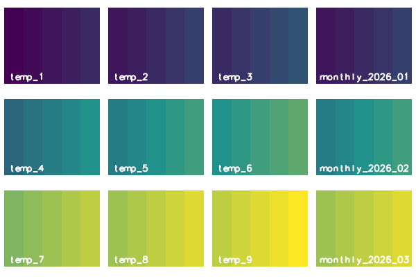

## DESCRIPTION

*t.rast.aggregate* aggregates the raster maps of a space time raster dataset
over regular periods of time, the granules, and registers the results as the
maps of a new space time raster dataset. A granule is a time interval of the
length **granularity**; the granules follow each other without a gap. Each new
map holds, for every cell, the result of an aggregation method over the input
maps that are related to its granule. Daily maps give monthly maps with
**granularity** `1 months`, for instance. The tool runs
*[r.series](r.series.md)* for every granule, so the methods and the results
are those of *r.series*. See the
[introduction to temporal data processing](temporalintro.md) for space time
datasets, and *[t.rast.aggregate.ds](t.rast.aggregate.ds.md)* for granules
that are given by the maps of another dataset.

The option **input** names the space time raster dataset; `input=name.label`
selects the maps of one semantic label. The option **output** names the new
space time raster dataset. It takes the temporal type, the semantic type, the
title and the description of the input dataset; its aggregation type is the
**method**. The option **where** takes an SQL condition on the registered maps
and selects the input maps, for instance by their `start_time`; without it,
all maps are used.

### Granules

The option **granularity** gives the length of a granule. In absolute time it
is one number and one unit, for instance `1 months` or `12 hours`; the units
are `seconds`, `minutes`, `hours`, `days`, `weeks`, `months` and `years`.
In relative time it is an integer, counted in the unit of the input dataset.

The first granule starts at the start of the first selected map, moved back to
the beginning of the unit of the granularity: a year to 1 January, a month to
the first of the month, a day to 00:00:00, an hour to the full hour, a minute
to the full minute. The fourth example shows this for each unit. The grid ends
with the granule that holds the end of the last map, or the last map itself if
it is a time instant.

The option **sampling** is a list of temporal relations, `contains` by
default; it sets which maps belong to a granule. The relation is read from the
granule: with `contains`, a map lies within the granule; with `equal`, the map
has the start and the end of the granule; with `overlaps`, the granule starts
before the map starts and ends within the map. The other relations are
`overlapped`, `starts`, `started`, `finishes`, `finished` and `during`.
Several relations are separated by commas; a map that fits two of them, for
instance `during` and `starts`, is aggregated once. The fifth example shows
`contains`, `overlaps` and `equal`.

### Aggregation

The option **method** is the aggregation of *r.series*: `average` (the
default), `count`, `median`, `mode`, `minimum`, `min_raster`, `maximum`,
`max_raster`, `stddev`, `range`, `sum`, `variance`, `diversity`, `slope`,
`offset`, `detcoeff`, `quart1`, `quart3`, `perc90`, `quantile`, `skewness` and
`kurtosis`. The maps of a granule are read in the order of their time, which
matters for `min_raster`, `max_raster`, `slope`, `offset` and `detcoeff`.
*r.series* skips null cells, so a cell is aggregated over the maps that have a
value there. The method `quantile` has no quantile option in this tool, so
*r.series* uses the quantile `0`, and the result is the smallest value.

The flag **-n** registers the maps whose cells are all null. Without it, a
granule whose related maps hold only null cells gives no new map. A granule
without any related map gives no map in either case.

### Names of the new maps

The new maps are named after the option **basename**, followed by an
underscore and a suffix that the option **suffix** chooses:

- `gran` (the default) takes the start time of the granule, cut to the unit of
  the granularity: `2026` for years, `2026_01` for months, `2026_01_12` for
  days or weeks, `2026_01_14_12` for hours and `2026_01_14_12_30` for minutes;
- `time` takes the full start time, for instance `2026_01_01T00_00_00`;
- `num` takes the number of the granule, from 1, with five digits; `num%NN`
  takes NN digits, so `num%03` gives `001`.

The option **offset** is added to the number of `num`, `0` by default. A
granule without a related map gives no map, but its number is used, so a
numbered series can have a gap. In relative time, every suffix gives the
number, because a relative time has no calendar date.

### Computation

*r.series* keeps every map of a granule open once per thread and needs two
files per map and thread. The tool therefore runs *r.series* with the flag
**-z**, which reads the maps row by row, when the maps of a granule exceed
**file_limit** (`1000` by default) or when 2 x threads x maps + 64 exceeds the
limit of open files of the process (`ulimit -n`). The threads are counted from
`NPROCS` of the GRASS session (see *g.gisenv*), else `OMP_NUM_THREADS`, else
the usable processors. With a raster mask (see *r.mask*), *r.series* runs one
thread, and so does the count. In a GRASS built without OpenMP, *r.series*
runs one thread; the count does not know this and may set **-z** earlier than
needed. The tool warns whenever it sets the flag. Without a limit on open
files, or without the Python module `resource` (for example on Windows),
**file_limit** alone counts. The flag does not change the result but is
slower: for 100 maps of 1000 x 1000 cells, *r.series* took 5.2 s with **-z**
instead of 0.25 s (measured 31.10.2026 with method sum, three runs). The eighth
example sets a low **file_limit**.

The option **nprocs** sets how many granules are aggregated at the same time,
`1` by default; a value below `1` runs one process. The result does not depend
on **nprocs**.

## NOTES

The tool computes the new maps in the current computational region, as
*r.series* does; see *g.region*.

A granule with a single related map is copied as it is: the method does not
matter, and the value, the type of the map (`CELL` stays `CELL`) and its colour
table stay as they were.

An existing **output** dataset is replaced only with **--overwrite**; without
it the tool refuses with one message. The tool stops before the computation if
the name of a new map equals the name of a map of the input dataset in the
current mapset.

A dot in the name of the new dataset is refused, for instance for
`output=my.out`, with the message "`<my.out>` is not a valid name for a new
space time dataset: a dot is not allowed".

The input dataset can be in another mapset of the project; the name with the
mapset (`input=temp@PERMANENT`) selects it. The new maps and the new dataset
are always created in the current mapset.

If no map is related to any granule, the tool warns, names the granularity and
the sampling, and creates no dataset; it ends without an error. With monthly
granules and maps that do not start on the first day of a month, for example a
series that starts on 31 January, the default sampling `contains` finds
nothing; `sampling=overlaps` relates each map to the granule in which it
starts and which it outlasts.

Wrong input stops the tool with a message before anything is written:

- An **input** dataset that does not exist: "Space time dataset `<name>` of
  type `<strds>` not found".
- A **where** that selects no map: "Space time raster dataset `<name>` is
  empty". An SQL error in **where** gives a message that begins with "Invalid
  where condition".
- An unknown **suffix**, for instance "Invalid suffix `<gram>`, use gran, time,
  num or num%NN" for `suffix=gram`.
- In absolute time, a **granularity** with another unit ("Wrong granularity
  format: 1 fortnight") or with a fraction ("Cannot read '1.5 days' as a time
  step"); without a unit, as in `2`, the message is "Invalid granularity
  `<2>`".
- In relative time, a **granularity** that is not an integer ("Invalid
  granularity `<1.5>`") or not positive ("The granularity 0 must be
  positive").

For **granularity** in `weeks`, the start of the first granule is wrong when
the first selected map starts in the first days of a month: when the day of
its month is not greater than the number of its weekday, counted from Monday
as 0. The first granule then starts after that map and does not contain it.
If no other map is related to a granule, the tool warns and creates no dataset;
the fourth example shows this. With `granularity="7 days"`, the first granule
starts at 00:00:00 on the day of the first map, so the granules are not tied to
Mondays.

## EXAMPLES

<!-- markdownlint-disable MD046 -->

### Aggregate to monthly averages

The dataset `temp` holds nine maps of air temperature on a region of 5 by 4
cells, three in each of January, February and March 2026, at the 1st, the 11th
and the 21st of the month. Every map is a time instant. The value of a cell is
its column number, 1 to 5, plus 0, 2 and 4 in January, 10, 12 and 14 in
February, and 20, 22 and 24 in March.

With **granularity** `1 months`, each month is a granule that contains its
three maps, and **method** `average` gives, in each cell, the column number
plus 2, 12 and 22. The first block creates the data, aggregates, and lists
the new maps with their granules and with the smallest and largest value of
each map: 3 and 7 in January, 13 and 17 in February, 23 and 27 in March. The
second block prints the statistics of the new maps with
*[t.rast.univar](t.rast.univar.md)*. The mean of the cells is the mean of the
columns, 3, plus 2, 12 and 22, so 5, 15 and 25.

=== "Command line"

    ```sh
    g.region n=4 s=0 e=5 w=0 res=1
    for map in "temp_1 0" "temp_2 2" "temp_3 4" "temp_4 10" "temp_5 12" \
        "temp_6 14" "temp_7 20" "temp_8 22" "temp_9 24"; do
        set -- $map
        r.mapcalc expression="$1 = col() + $2"
    done
    t.create output=temp title="Air temperature" \
        description="Three readings per month"
    t.register input=temp maps=temp_1,temp_2,temp_3 \
        start=2026-01-01 increment="10 days"
    t.register input=temp maps=temp_4,temp_5,temp_6 \
        start=2026-02-01 increment="10 days"
    t.register input=temp maps=temp_7,temp_8,temp_9 \
        start=2026-03-01 increment="10 days"
    t.rast.aggregate input=temp output=monthly basename=monthly \
        granularity="1 months" method=average
    t.rast.list input=monthly columns=name,start_time,end_time,min,max
    ```

    ```text
    name|start_time|end_time|min|max
    monthly_2026_01|2026-01-01 00:00:00|2026-02-01 00:00:00|3.0|7.0
    monthly_2026_02|2026-02-01 00:00:00|2026-03-01 00:00:00|13.0|17.0
    monthly_2026_03|2026-03-01 00:00:00|2026-04-01 00:00:00|23.0|27.0
    ```

    ```sh
    t.rast.univar input=monthly
    ```

    ```text
    id|semantic_label|start|end|non_null_cells|null_cells|min|max|range|mean|mean_of_abs|stddev|variance|coeff_var|sum|sum_abs
    monthly_2026_01@PERMANENT||2026-01-01 00:00:00|2026-02-01 00:00:00|20|0|3|7|4|5|5|1.4142135623731|2|28.2842712474619|100|100
    monthly_2026_02@PERMANENT||2026-02-01 00:00:00|2026-03-01 00:00:00|20|0|13|17|4|15|15|1.4142135623731|2|9.42809041582064|300|300
    monthly_2026_03@PERMANENT||2026-03-01 00:00:00|2026-04-01 00:00:00|20|0|23|27|4|25|25|1.4142135623731|2|5.65685424949238|500|500
    ```

=== "Python (grass.tools)"

    ```python
    from grass.tools import Tools

    tools = Tools()
    tools.g_region(n=4, s=0, e=5, w=0, res=1)
    offsets = {1: 0, 2: 2, 3: 4, 4: 10, 5: 12, 6: 14, 7: 20, 8: 22, 9: 24}
    for number, offset in offsets.items():
        tools.r_mapcalc(expression=f"temp_{number} = col() + {offset}")
    tools.t_create(
        output="temp", title="Air temperature", description="Three readings per month"
    )
    for maps, start in (
        ("temp_1,temp_2,temp_3", "2026-01-01"),
        ("temp_4,temp_5,temp_6", "2026-02-01"),
        ("temp_7,temp_8,temp_9", "2026-03-01"),
    ):
        tools.t_register(input="temp", maps=maps, start=start, increment="10 days")
    tools.t_rast_aggregate(
        input="temp",
        output="monthly",
        basename="monthly",
        granularity="1 months",
        method="average",
    )
    print(
        tools.t_rast_list(input="monthly", columns="name,start_time,end_time,min,max").text
    )
    ```

    ```text
    name|start_time|end_time|min|max
    monthly_2026_01|2026-01-01 00:00:00|2026-02-01 00:00:00|3.0|7.0
    monthly_2026_02|2026-02-01 00:00:00|2026-03-01 00:00:00|13.0|17.0
    monthly_2026_03|2026-03-01 00:00:00|2026-04-01 00:00:00|23.0|27.0
    ```

    ```python
    print(tools.t_rast_univar(input="monthly").text)
    ```

    ```text
    id|semantic_label|start|end|non_null_cells|null_cells|min|max|range|mean|mean_of_abs|stddev|variance|coeff_var|sum|sum_abs
    monthly_2026_01@PERMANENT||2026-01-01 00:00:00|2026-02-01 00:00:00|20|0|3|7|4|5|5|1.4142135623731|2|28.2842712474619|100|100
    monthly_2026_02@PERMANENT||2026-02-01 00:00:00|2026-03-01 00:00:00|20|0|13|17|4|15|15|1.4142135623731|2|9.42809041582064|300|300
    monthly_2026_03@PERMANENT||2026-03-01 00:00:00|2026-04-01 00:00:00|20|0|23|27|4|25|25|1.4142135623731|2|5.65685424949238|500|500
    ```

### Compare the maps before and after

The figure shows the nine maps of `temp` in three rows, one row per month, and
at the right of each row the monthly average of that month, from the previous
example. All maps share one colour table, from the smallest value 1 to the
largest value 29, so the same colour means the same temperature in all twelve
maps. *r.colors* sets the table, *d.frame* makes one frame per map, *d.rast*
draws the map and *d.text* names it.

=== "Command line"

    ```sh
    for maps in temp_1,temp_2,temp_3,temp_4,temp_5,temp_6,temp_7,temp_8,temp_9 \
        monthly_2026_01,monthly_2026_02,monthly_2026_03; do
        r.colors map=$maps rules=- <<EOF
    1 68:1:84
    15 33:145:140
    29 253:231:37
    EOF
    done
    d.mon start=cairo output=t_rast_aggregate_months.png width=600 height=400
    for month in 01 02 03; do
        row=$((10#$month - 1))
        top=$((99 - 33 * row))
        col=0
        for map in temp_$((3 * row + 1)) temp_$((3 * row + 2)) \
            temp_$((3 * row + 3)) monthly_2026_$month; do
            d.frame -c frame=f_${row}_$col at=$((top - 31)),$top,$((25 * col + 1)),$((25 * col + 24))
            d.rast map=$map
            d.text text=$map at=5,5 size=12 color=white
            col=$((col + 1))
        done
    done
    d.mon stop=cairo
    ```

=== "Python (grass.tools)"

    ```python
    from io import StringIO

    rules = "1 68:1:84\n15 33:145:140\n29 253:231:37\n"
    for maps in (
        "temp_1,temp_2,temp_3,temp_4,temp_5,temp_6,temp_7,temp_8,temp_9",
        "monthly_2026_01,monthly_2026_02,monthly_2026_03",
    ):
        tools.r_colors(map=maps, rules=StringIO(rules))
    tools.d_mon(start="cairo", output="t_rast_aggregate_months.png", width=600, height=400)
    for row, month in enumerate(("01", "02", "03")):
        top = 99 - 33 * row
        names = [f"temp_{3 * row + step}" for step in (1, 2, 3)]
        for col, name in enumerate(names + [f"monthly_2026_{month}"]):
            tools.d_frame(
                flags="c",
                frame=f"f_{row}_{col}",
                at=[top - 31, top, 25 * col + 1, 25 * col + 24],
            )
            tools.d_rast(map=name)
            tools.d_text(text=name, at=[5, 5], size=12, color="white")
    tools.d_mon(stop="cairo")
    ```



*Figure: The three maps of each month, from January at the top to March at the
bottom, and their monthly average at the right.*

### Choose the method and the names of the new maps

Three more aggregations of `temp`, each with a different **method**, a
different **suffix** and, in the second block, an **offset**. The output lists
the maps with their granules and the smallest and the largest value.

1. **method** `maximum` with **suffix** `time` names the maps with the full
   start time. The largest value of a cell in January is its column number
   plus 4, so the maps hold 5 to 9 in January, 15 to 19 in February and 25 to
   29 in March.
2. **method** `minimum` with **suffix** `num%03` and **offset** `10` numbers
   the maps with three digits, counting from 1 plus the offset: 11, 12 and 13.
   The smallest value of a cell is its column number plus 0, 10 and 20, so
   the maps hold 1 to 5, 11 to 15 and 21 to 25.
3. **granularity** `2 months` with **method** `sum` makes granules of two
   months, January and February, and March and April. The sum of the six maps
   of the first granule in a cell is six times its column number plus 42, so
   the first map holds 48 to 72; the three maps of March sum to three times
   the column number plus 66, so the second map holds 69 to 81.

=== "Command line"

    ```sh
    t.rast.aggregate input=temp output=top basename=top \
        granularity="1 months" method=maximum suffix=time
    t.rast.list input=top columns=name,start_time,min,max
    ```

    ```text
    name|start_time|min|max
    top_2026_01_01T00_00_00|2026-01-01 00:00:00|5.0|9.0
    top_2026_02_01T00_00_00|2026-02-01 00:00:00|15.0|19.0
    top_2026_03_01T00_00_00|2026-03-01 00:00:00|25.0|29.0
    ```

    ```sh
    t.rast.aggregate input=temp output=bottom basename=bottom \
        granularity="1 months" method=minimum suffix=num%03 offset=10
    t.rast.list input=bottom columns=name,start_time,min,max
    ```

    ```text
    name|start_time|min|max
    bottom_011|2026-01-01 00:00:00|1.0|5.0
    bottom_012|2026-02-01 00:00:00|11.0|15.0
    bottom_013|2026-03-01 00:00:00|21.0|25.0
    ```

    ```sh
    t.rast.aggregate input=temp output=bimonthly basename=bimonthly \
        granularity="2 months" method=sum
    t.rast.list input=bimonthly columns=name,start_time,end_time,min,max
    ```

    ```text
    name|start_time|end_time|min|max
    bimonthly_2026_01|2026-01-01 00:00:00|2026-03-01 00:00:00|48.0|72.0
    bimonthly_2026_03|2026-03-01 00:00:00|2026-05-01 00:00:00|69.0|81.0
    ```

=== "Python (grass.tools)"

    ```python
    tools.t_rast_aggregate(
        input="temp",
        output="top",
        basename="top",
        granularity="1 months",
        method="maximum",
        suffix="time",
    )
    print(tools.t_rast_list(input="top", columns="name,start_time,min,max").text)
    ```

    ```text
    name|start_time|min|max
    top_2026_01_01T00_00_00|2026-01-01 00:00:00|5.0|9.0
    top_2026_02_01T00_00_00|2026-02-01 00:00:00|15.0|19.0
    top_2026_03_01T00_00_00|2026-03-01 00:00:00|25.0|29.0
    ```

    ```python
    tools.t_rast_aggregate(
        input="temp",
        output="bottom",
        basename="bottom",
        granularity="1 months",
        method="minimum",
        suffix="num%03",
        offset=10,
    )
    print(tools.t_rast_list(input="bottom", columns="name,start_time,min,max").text)
    ```

    ```text
    name|start_time|min|max
    bottom_011|2026-01-01 00:00:00|1.0|5.0
    bottom_012|2026-02-01 00:00:00|11.0|15.0
    bottom_013|2026-03-01 00:00:00|21.0|25.0
    ```

    ```python
    tools.t_rast_aggregate(
        input="temp",
        output="bimonthly",
        basename="bimonthly",
        granularity="2 months",
        method="sum",
    )
    print(
        tools.t_rast_list(
            input="bimonthly", columns="name,start_time,end_time,min,max"
        ).text
    )
    ```

    ```text
    name|start_time|end_time|min|max
    bimonthly_2026_01|2026-01-01 00:00:00|2026-03-01 00:00:00|48.0|72.0
    bimonthly_2026_03|2026-03-01 00:00:00|2026-05-01 00:00:00|69.0|81.0
    ```

### Where the first granule starts

The dataset `clock` holds three time instants on 14 January 2026, a Wednesday, at
12:30:45, 12:31:10 and 12:31:35, with the values 1, 2 and 3. The first block
aggregates it with six granularities, from years to minutes, and lists the new
maps of each. The first granule starts at the beginning of the unit of the
granularity: `2026-01-01` for years, `2026-01-01` for months, `2026-01-12`
(the Monday) for weeks, `2026-01-14` for days, `12:00:00` for hours and
`12:30:00` for minutes. With minutes, the first instant (12:30:45) lies in
the granule from 12:30 and the other two (12:31:10 and 12:31:35) in the granule
from 12:31, so there are two granules.

The second block shows the trap of the weeks. The dataset `early` holds one
map at 3 January 2026, a Saturday, which has the weekday number 5 and lies on
the 3rd, a day not greater than 5. The tool warns that no map is related to any
granule, because the first granule starts after the map, and creates no
dataset, as the list of the datasets shows; with `7 days`, the granule starts
on the day of the map.

=== "Command line"

    ```sh
    r.mapcalc expression="clock_1 = 1"
    r.mapcalc expression="clock_2 = 2"
    r.mapcalc expression="clock_3 = 3"
    t.create output=clock title="Clock" description="Three instants"
    t.register input=clock maps=clock_1,clock_2,clock_3 \
        start="2026-01-14 12:30:45" increment="25 seconds"
    for unit in years months weeks days hours minutes; do
        t.rast.aggregate input=clock output=by_$unit basename=by_$unit \
            granularity="1 $unit" method=sum
        t.rast.list input=by_$unit columns=name,start_time,end_time
    done
    ```

    ```text
    name|start_time|end_time
    by_years_2026|2026-01-01 00:00:00|2027-01-01 00:00:00
    name|start_time|end_time
    by_months_2026_01|2026-01-01 00:00:00|2026-02-01 00:00:00
    name|start_time|end_time
    by_weeks_2026_01_12|2026-01-12 00:00:00|2026-01-19 00:00:00
    name|start_time|end_time
    by_days_2026_01_14|2026-01-14 00:00:00|2026-01-15 00:00:00
    name|start_time|end_time
    by_hours_2026_01_14_12|2026-01-14 12:00:00|2026-01-14 13:00:00
    name|start_time|end_time
    by_minutes_2026_01_14_12_30|2026-01-14 12:30:00|2026-01-14 12:31:00
    by_minutes_2026_01_14_12_31|2026-01-14 12:31:00|2026-01-14 12:32:00
    ```

    ```sh
    r.mapcalc expression="early_1 = 1"
    t.create output=early title="Early" description="One map in a first week"
    t.register input=early maps=early_1 start=2026-01-03
    t.rast.aggregate input=early output=early_weeks basename=early_weeks \
        granularity="1 weeks" method=sum
    t.rast.aggregate input=early output=early_days basename=early_days \
        granularity="7 days" method=sum
    t.rast.list input=early_days columns=name,start_time,end_time
    t.list type=strds columns=name
    ```

    ```text
    name|start_time|end_time
    early_days_2026_01_03|2026-01-03 00:00:00|2026-01-10 00:00:00
    bimonthly
    bottom
    by_days
    by_hours
    by_minutes
    by_months
    by_weeks
    by_years
    clock
    early
    early_days
    monthly
    temp
    top
    ```

=== "Python (grass.tools)"

    ```python
    for number in (1, 2, 3):
        tools.r_mapcalc(expression=f"clock_{number} = {number}")
    tools.t_create(output="clock", title="Clock", description="Three instants")
    tools.t_register(
        input="clock",
        maps="clock_1,clock_2,clock_3",
        start="2026-01-14 12:30:45",
        increment="25 seconds",
    )
    for unit in ("years", "months", "weeks", "days", "hours", "minutes"):
        tools.t_rast_aggregate(
            input="clock",
            output=f"by_{unit}",
            basename=f"by_{unit}",
            granularity=f"1 {unit}",
            method="sum",
        )
        print(
            tools.t_rast_list(input=f"by_{unit}", columns="name,start_time,end_time").text
        )
    ```

    ```text
    name|start_time|end_time
    by_years_2026|2026-01-01 00:00:00|2027-01-01 00:00:00
    name|start_time|end_time
    by_months_2026_01|2026-01-01 00:00:00|2026-02-01 00:00:00
    name|start_time|end_time
    by_weeks_2026_01_12|2026-01-12 00:00:00|2026-01-19 00:00:00
    name|start_time|end_time
    by_days_2026_01_14|2026-01-14 00:00:00|2026-01-15 00:00:00
    name|start_time|end_time
    by_hours_2026_01_14_12|2026-01-14 12:00:00|2026-01-14 13:00:00
    name|start_time|end_time
    by_minutes_2026_01_14_12_30|2026-01-14 12:30:00|2026-01-14 12:31:00
    by_minutes_2026_01_14_12_31|2026-01-14 12:31:00|2026-01-14 12:32:00
    ```

    ```python
    tools.r_mapcalc(expression="early_1 = 1")
    tools.t_create(output="early", title="Early", description="One map in a first week")
    tools.t_register(input="early", maps="early_1", start="2026-01-03")
    tools.t_rast_aggregate(
        input="early",
        output="early_weeks",
        basename="early_weeks",
        granularity="1 weeks",
        method="sum",
    )
    tools.t_rast_aggregate(
        input="early",
        output="early_days",
        basename="early_days",
        granularity="7 days",
        method="sum",
    )
    print(tools.t_rast_list(input="early_days", columns="name,start_time,end_time").text)
    print(tools.t_list(type="strds", columns="name").text)
    ```

    ```text
    name|start_time|end_time
    early_days_2026_01_03|2026-01-03 00:00:00|2026-01-10 00:00:00
    bimonthly
    bottom
    by_days
    by_hours
    by_minutes
    by_months
    by_weeks
    by_years
    clock
    early
    early_days
    monthly
    temp
    top
    ```

### Choose the maps of a granule

The dataset `periods` holds four maps of ten days each, `p_1` to `p_4`, with
the values 1 to 4 in every cell. The maps follow each other: `p_1` runs from
21 to 31 January, `p_2` from 31 January to 10 February, `p_3` from 10 to
20 February and `p_4` from 20 February to 2 March. Two maps cross the border of
a month.

With the default **sampling** `contains` and monthly granules, only `p_1`
lies within January and only `p_3` within February: each granule has a single
map and copies it, so the new maps hold 1 and 3. With `contains,overlaps`, the
granule January also takes `p_2`, because the granule starts before the map
and ends within it, and the granule February takes `p_4`; the sums are 1 + 2 =
3 and 3 + 4 = 7. The third block adds **where**, which leaves out the maps
that start before February: only `p_3` and `p_4` are left, and the first
granule starts on 1 February, the beginning of the month of `p_3`. The fourth
block aggregates the three monthly maps of the first example: each has the
start and the end of a granule, so **sampling** `equal` relates it to that
granule, and the granule copies it.

=== "Command line"

    ```sh
    for number in 1 2 3 4; do
        r.mapcalc expression="p_$number = $number"
    done
    t.create output=periods title="Periods" description="Ten day periods"
    t.register input=periods maps=p_1 start=2026-01-21 end=2026-01-31
    t.register input=periods maps=p_2 start=2026-01-31 end=2026-02-10
    t.register input=periods maps=p_3 start=2026-02-10 end=2026-02-20
    t.register input=periods maps=p_4 start=2026-02-20 end=2026-03-02
    t.rast.aggregate input=periods output=contained basename=contained \
        granularity="1 months" method=sum
    t.rast.list input=contained columns=name,start_time,min,max
    ```

    ```text
    name|start_time|min|max
    contained_2026_01|2026-01-01 00:00:00|1.0|1.0
    contained_2026_02|2026-02-01 00:00:00|3.0|3.0
    ```

    ```sh
    t.rast.aggregate input=periods output=touched basename=touched \
        granularity="1 months" method=sum sampling=contains,overlaps
    t.rast.list input=touched columns=name,start_time,min,max
    ```

    ```text
    name|start_time|min|max
    touched_2026_01|2026-01-01 00:00:00|3.0|3.0
    touched_2026_02|2026-02-01 00:00:00|7.0|7.0
    ```

    ```sh
    t.rast.aggregate input=periods output=february basename=february \
        granularity="1 months" method=sum sampling=contains,overlaps \
        where="start_time >= '2026-02-01'"
    t.rast.list input=february columns=name,start_time,min,max
    ```

    ```text
    name|start_time|min|max
    february_2026_02|2026-02-01 00:00:00|7.0|7.0
    ```

    ```sh
    t.rast.aggregate input=monthly output=copied basename=copied \
        granularity="1 months" method=sum sampling=equal
    t.rast.list input=copied columns=name,start_time,min,max
    ```

    ```text
    name|start_time|min|max
    copied_2026_01|2026-01-01 00:00:00|3.0|7.0
    copied_2026_02|2026-02-01 00:00:00|13.0|17.0
    copied_2026_03|2026-03-01 00:00:00|23.0|27.0
    ```

=== "Python (grass.tools)"

    ```python
    for number in (1, 2, 3, 4):
        tools.r_mapcalc(expression=f"p_{number} = {number}")
    tools.t_create(output="periods", title="Periods", description="Ten day periods")
    for number, start, end in (
        (1, "2026-01-21", "2026-01-31"),
        (2, "2026-01-31", "2026-02-10"),
        (3, "2026-02-10", "2026-02-20"),
        (4, "2026-02-20", "2026-03-02"),
    ):
        tools.t_register(input="periods", maps=f"p_{number}", start=start, end=end)
    tools.t_rast_aggregate(
        input="periods",
        output="contained",
        basename="contained",
        granularity="1 months",
        method="sum",
    )
    print(tools.t_rast_list(input="contained", columns="name,start_time,min,max").text)
    ```

    ```text
    name|start_time|min|max
    contained_2026_01|2026-01-01 00:00:00|1.0|1.0
    contained_2026_02|2026-02-01 00:00:00|3.0|3.0
    ```

    ```python
    tools.t_rast_aggregate(
        input="periods",
        output="touched",
        basename="touched",
        granularity="1 months",
        method="sum",
        sampling="contains,overlaps",
    )
    print(tools.t_rast_list(input="touched", columns="name,start_time,min,max").text)
    ```

    ```text
    name|start_time|min|max
    touched_2026_01|2026-01-01 00:00:00|3.0|3.0
    touched_2026_02|2026-02-01 00:00:00|7.0|7.0
    ```

    ```python
    tools.t_rast_aggregate(
        input="periods",
        output="february",
        basename="february",
        granularity="1 months",
        method="sum",
        sampling="contains,overlaps",
        where="start_time >= '2026-02-01'",
    )
    print(tools.t_rast_list(input="february", columns="name,start_time,min,max").text)
    ```

    ```text
    name|start_time|min|max
    february_2026_02|2026-02-01 00:00:00|7.0|7.0
    ```

    ```python
    tools.t_rast_aggregate(
        input="monthly",
        output="copied",
        basename="copied",
        granularity="1 months",
        method="sum",
        sampling="equal",
    )
    print(tools.t_rast_list(input="copied", columns="name,start_time,min,max").text)
    ```

    ```text
    name|start_time|min|max
    copied_2026_01|2026-01-01 00:00:00|3.0|7.0
    copied_2026_02|2026-02-01 00:00:00|13.0|17.0
    copied_2026_03|2026-03-01 00:00:00|23.0|27.0
    ```

### Null cells and empty granules

The dataset `gappy` holds five maps. In January, `g_1` has the column number
as value and `g_2` the column number plus 2, except in column 1, where it is
null. February has two maps with only null cells, `g_3` and `g_4`; March has
`g_5`, again the column number. The January average skips the null cell:
column 1 holds 1, taken from `g_1` alone, and the other columns hold the
column number plus 1, so the smallest value is 1 and the largest 6.

Without **-n**, February gives no map, because all its cells are null, so the
dataset has two maps. The second block aggregates again with **-n**; the
**--overwrite** replaces the dataset of the first block and its maps. February
is now registered, and its map has no smallest and no largest value, which the
list shows as `None`.

=== "Command line"

    ```sh
    r.mapcalc expression="g_1 = col()"
    r.mapcalc expression="g_2 = if(col() == 1, null(), col() + 2)"
    r.mapcalc expression="g_3 = null()"
    r.mapcalc expression="g_4 = null()"
    r.mapcalc expression="g_5 = col()"
    t.create output=gappy title="Gappy" description="Maps with null cells"
    t.register input=gappy maps=g_1,g_2 start=2026-01-01 increment="10 days"
    t.register input=gappy maps=g_3,g_4 start=2026-02-01 increment="10 days"
    t.register input=gappy maps=g_5 start=2026-03-01
    t.rast.aggregate input=gappy output=gappy_monthly basename=gappy \
        granularity="1 months" method=average
    t.rast.list input=gappy_monthly columns=name,start_time,min,max
    ```

    ```text
    name|start_time|min|max
    gappy_2026_01|2026-01-01 00:00:00|1.0|6.0
    gappy_2026_03|2026-03-01 00:00:00|1.0|5.0
    ```

    ```sh
    t.rast.aggregate -n input=gappy output=gappy_monthly basename=gappy \
        granularity="1 months" method=average --overwrite
    t.rast.list input=gappy_monthly columns=name,start_time,min,max
    ```

    ```text
    name|start_time|min|max
    gappy_2026_01|2026-01-01 00:00:00|1.0|6.0
    gappy_2026_02|2026-02-01 00:00:00|None|None
    gappy_2026_03|2026-03-01 00:00:00|1.0|5.0
    ```

=== "Python (grass.tools)"

    ```python
    tools.r_mapcalc(expression="g_1 = col()")
    tools.r_mapcalc(expression="g_2 = if(col() == 1, null(), col() + 2)")
    tools.r_mapcalc(expression="g_3 = null()")
    tools.r_mapcalc(expression="g_4 = null()")
    tools.r_mapcalc(expression="g_5 = col()")
    tools.t_create(output="gappy", title="Gappy", description="Maps with null cells")
    for maps, start in (
        ("g_1,g_2", "2026-01-01"),
        ("g_3,g_4", "2026-02-01"),
    ):
        tools.t_register(input="gappy", maps=maps, start=start, increment="10 days")
    tools.t_register(input="gappy", maps="g_5", start="2026-03-01")
    tools.t_rast_aggregate(
        input="gappy",
        output="gappy_monthly",
        basename="gappy",
        granularity="1 months",
        method="average",
    )
    print(tools.t_rast_list(input="gappy_monthly", columns="name,start_time,min,max").text)
    ```

    ```text
    name|start_time|min|max
    gappy_2026_01|2026-01-01 00:00:00|1.0|6.0
    gappy_2026_03|2026-03-01 00:00:00|1.0|5.0
    ```

    ```python
    tools.t_rast_aggregate(
        input="gappy",
        output="gappy_monthly",
        basename="gappy",
        granularity="1 months",
        method="average",
        flags="n",
        overwrite=True,
    )
    print(tools.t_rast_list(input="gappy_monthly", columns="name,start_time,min,max").text)
    ```

    ```text
    name|start_time|min|max
    gappy_2026_01|2026-01-01 00:00:00|1.0|6.0
    gappy_2026_02|2026-02-01 00:00:00|None|None
    gappy_2026_03|2026-03-01 00:00:00|1.0|5.0
    ```

### Aggregate relative time

The dataset `model` holds four maps `step_1` to `step_4` with the values 1 to 4,
one for each hour, from 0 to 4. With the integer **granularity** `2`, the
granules are two hours long, in the unit of the dataset, and the sums are
1 + 2 = 3 and 3 + 4 = 7. In relative time every **suffix** gives the number of
the granule, so the new maps are numbered with five digits.

=== "Command line"

    ```sh
    for number in 1 2 3 4; do
        r.mapcalc expression="step_$number = $number"
    done
    t.create output=model temporaltype=relative title="Model" \
        description="Model output per step"
    t.register -i input=model maps=step_1,step_2,step_3,step_4 \
        start=0 increment=1 unit=hours
    t.rast.aggregate input=model output=pairs basename=pair \
        granularity=2 method=sum
    t.rast.list input=pairs columns=name,start_time,end_time,min,max
    ```

    ```text
    name|start_time|end_time|min|max
    pair_00001|0|2|3.0|3.0
    pair_00002|2|4|7.0|7.0
    ```

=== "Python (grass.tools)"

    ```python
    for number in (1, 2, 3, 4):
        tools.r_mapcalc(expression=f"step_{number} = {number}")
    tools.t_create(
        output="model",
        temporaltype="relative",
        title="Model",
        description="Model output per step",
    )
    tools.t_register(
        input="model",
        maps="step_1,step_2,step_3,step_4",
        start=0,
        increment=1,
        unit="hours",
        flags="i",
    )
    tools.t_rast_aggregate(
        input="model", output="pairs", basename="pair", granularity=2, method="sum"
    )
    print(tools.t_rast_list(input="pairs", columns="name,start_time,end_time,min,max").text)
    ```

    ```text
    name|start_time|end_time|min|max
    pair_00001|0|2|3.0|3.0
    pair_00002|2|4|7.0|7.0
    ```

### Many maps in a granule and parallel granules

The three maps of a month exceed **file_limit** `2`, so the tool runs
*r.series* with the flag **-z** and warns once for each granule; the message
goes to the error output and is not shown here. **nprocs** `3` aggregates the
three months at the same time. The result does not change: the sums of the
three maps of a month are three times the column number plus 6, 36 and 66, so
9 to 21, 39 to 51 and 69 to 81.

=== "Command line"

    ```sh
    t.rast.aggregate input=temp output=monthly_sum basename=monthly_sum \
        granularity="1 months" method=sum nprocs=3 file_limit=2
    t.rast.list input=monthly_sum columns=name,start_time,min,max
    ```

    ```text
    name|start_time|min|max
    monthly_sum_2026_01|2026-01-01 00:00:00|9.0|21.0
    monthly_sum_2026_02|2026-02-01 00:00:00|39.0|51.0
    monthly_sum_2026_03|2026-03-01 00:00:00|69.0|81.0
    ```

=== "Python (grass.tools)"

    ```python
    tools.t_rast_aggregate(
        input="temp",
        output="monthly_sum",
        basename="monthly_sum",
        granularity="1 months",
        method="sum",
        nprocs=3,
        file_limit=2,
    )
    print(tools.t_rast_list(input="monthly_sum", columns="name,start_time,min,max").text)
    ```

    ```text
    name|start_time|min|max
    monthly_sum_2026_01|2026-01-01 00:00:00|9.0|21.0
    monthly_sum_2026_02|2026-02-01 00:00:00|39.0|51.0
    monthly_sum_2026_03|2026-03-01 00:00:00|69.0|81.0
    ```

### Aggregate a dataset of another mapset

The new mapset `second` has its own region and no dataset of its own. The input
`temp@PERMANENT` names the dataset of the mapset `PERMANENT`; the new maps and
the new dataset are created in `second`, as the column `mapset` shows.

=== "Command line"

    ```sh
    g.mapset -c mapset=second
    t.rast.aggregate input=temp@PERMANENT output=monthly_copy \
        basename=monthly_copy granularity="1 months" method=average
    t.rast.list input=monthly_copy columns=name,mapset,start_time
    ```

    ```text
    name|mapset|start_time
    monthly_copy_2026_01|second|2026-01-01 00:00:00
    monthly_copy_2026_02|second|2026-02-01 00:00:00
    monthly_copy_2026_03|second|2026-03-01 00:00:00
    ```

=== "Python (grass.tools)"

    ```python
    tools.g_mapset(flags="c", mapset="second")
    tools.t_rast_aggregate(
        input="temp@PERMANENT",
        output="monthly_copy",
        basename="monthly_copy",
        granularity="1 months",
        method="average",
    )
    print(tools.t_rast_list(input="monthly_copy", columns="name,mapset,start_time").text)
    ```

    ```text
    name|mapset|start_time
    monthly_copy_2026_01|second|2026-01-01 00:00:00
    monthly_copy_2026_02|second|2026-02-01 00:00:00
    monthly_copy_2026_03|second|2026-03-01 00:00:00
    ```

<!-- markdownlint-enable MD046 -->

## SEE ALSO

*[g.region](g.region.md), [r.mask](r.mask.md), [r.series](r.series.md),
[t.info](t.info.md), [t.rast.aggregate.ds](t.rast.aggregate.ds.md),
[t.rast.extract](t.rast.extract.md), [t.rast.list](t.rast.list.md),
[t.rast.univar](t.rast.univar.md),
[temporal data processing](temporalintro.md)*

## AUTHOR

Sören Gebbert, Thünen Institute of Climate-Smart Agriculture
