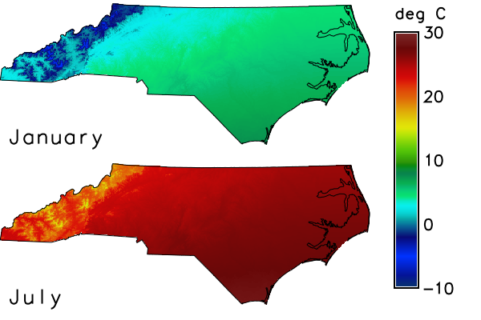

## DESCRIPTION

*t.rast.colors* creates or changes the color tables of the raster maps that are
registered in a space time raster dataset. It is a wrapper around
*[r.colors](r.colors.md)*: the tool writes the names of all registered maps to
a file and runs *r.colors* once with this file, so all maps are handled in one
run. A color table that is computed from the values of the maps, such as
`grey`, therefore stretches over the combined range of all maps of the dataset,
and all maps get the same rules. See the
[introduction to temporal data processing](temporalintro.md) for space time
datasets.

The option **input** names the space time raster dataset. Every registered map
is handled; there is no option to select maps. The source of the colors is
exactly one of the following; the flags **-r** and **-l** need none:

- **color** takes the name of a color table of *r.colors*, such as `grey` or
  `viridis`. A table that is defined for a fixed range of values, such as
  `celsius` (-80 to 80), keeps this range; a table without a fixed range is
  stretched over the range of the values of all maps.
- **rules** takes the path of a file with color rules, as *r.colors* reads
  them: one rule per line, a value and a color, such as `0 blue`. The value
  `-` reads the rules from the standard input.
- **raster** takes a raster map and copies its color table to all maps of the
  dataset, with the rules of that map.
- **raster_3d** does the same with the color table of a 3D raster map.

A table that a map has is replaced by the new one; **--overwrite** is not
needed.

The flags change how the table is made or what is done with it:

- **-n** inverts the colors: the color of the smallest value becomes that of
  the largest, and the other way round. *[r.colors.out](r.colors.out.md)*
  prints the same rules with and without the flag, so use
  *[r.what.color](r.what.color.md)* to see the inversion.
- **-g** scales the colors logarithmically, **-a** logarithmically with the
  absolute values, so a negative value gets the color of its absolute value.
  Both write a table of many rules that approximates the curve.
- **-e** equalizes the histogram: the colors are spread by the cumulative
  frequency of the values in the cells, so each cell gets about the same step
  of color, and not each interval of values.
- **-w** writes the new table only to the maps that have none. The table is
  computed from the data range of these maps only. Maps that have a table keep
  it, also a table that *r.colors* wrote in the current mapset for a map of
  another mapset.
- **-r** removes the color table of every map. A map without a table is shown
  with the default table of *r.colors* for its own range of values.
- **-l** prints the names of the color tables of **color** and stops.

## NOTES

Exactly one of **color**, **rules**, **raster**, **raster_3d**, **-r** and
**-l** is required. If none is given, *r.colors* stops with the message "At
least one of the following options is required: `<raster>`, `<raster_3d>`,
`<color>`, `<rules>`, `<-r>`, `<-l>` and `<-d>`" and *t.rast.colors* adds
"Error in r.colors call". More than one source is refused with "Options
`<color>`, `<rules>`, `<raster>` and `<raster_3d>` are mutually exclusive".

An unknown name in **color** is refused by the parser ("Value
`<nosuchtable>` out of range for parameter `<color>`"), and the maps keep their
tables. A missing file in **rules** stops with "Unable to load rules file"
and the path; an unknown map in **raster** stops with "Error in r.colors
call".

A dataset without maps is left alone, without a message.

Datasets with absolute and with relative time are handled in the same way;
the last example uses relative time.

For a dataset of another mapset (`input=temperature_monthly@t_rast_colors`),
*r.colors* writes the tables to the current mapset, where they take
precedence over the tables of the maps for as long as this mapset is the
current one. The maps in their own mapset are not changed, as the last example
shows.

## EXAMPLES

The examples run in the North Carolina sample dataset `nc_spm_08_grass7` from
the [GRASS sample data](https://grass.osgeo.org/download/data/). The first
example creates the mapset `t_rast_colors` and sets the computational region
to North Carolina with cells of 1 km; the later examples work in this mapset
and region, except the last, which creates a second mapset with the same
region. The color tables are written only to the maps of this mapset, never to
the maps of the sample dataset.

<!-- example-project: dataset=nc_spm_08_grass7 mapset=t_rast_colors -->

<!-- markdownlint-disable MD046 -->

### Give all maps one color table

The dataset `temperature_monthly` holds twelve maps of the monthly mean air
temperature in 2020, in degrees Celsius rounded to tenths. They are generated
from the elevation model `elev_state_500m`: 16.5 degrees at sea level and the
northing 160 km, an annual cycle of plus and minus 10.5 degrees with its
maximum in July, 6.5 degrees less for every 1000 m of elevation, and 1 degree
more for every 100 km to the south. The smallest value of all maps is -7.0
degrees, the largest 28.4 degrees.

With **color** `grey`, all maps get a table from black at the smallest value
of the dataset to white at the largest one, not one for the range of each map:
the first block prints the table of the January map and of the July map, which
is the same. The lines `nv` and `default` are the colors of null cells and of
values outside the table. A table with a fixed range keeps it: `celsius` runs
from -80 to 80, so the second block prints only the rules for -80 and 80 of
the table of the January map.

=== "Command line"

    ```sh
    g.mapset -c mapset=t_rast_colors
    g.region raster=elev_state_500m res=1000 -a
    for month in $(seq 12); do
        echo "temperature_monthly_2020_$(printf %02d $month) = round((16.5" \
            "+ 10.5 * cos(30 * ($month - 7.2)) - 0.0065 * elev_state_500m" \
            "- 0.00001 * (y() - 160000)) * 10) / 10.0"
    done | r.mapcalc file=-
    t.create output=temperature_monthly title="Air temperature" \
        description="Monthly mean air temperature 2020 in degree Celsius"
    t.register -i input=temperature_monthly \
        maps=$(g.list type=raster pattern="temperature_monthly_*" mapset=. separator=comma) \
        start=2020-01-01 increment="1 month"
    ```

    ```sh
    t.rast.colors input=temperature_monthly color=grey
    r.colors.out map=temperature_monthly_2020_01
    r.colors.out map=temperature_monthly_2020_07
    ```

    ```text
    -7 0:0:0
    28.4 255:255:255
    nv 255:255:255
    default 255:255:255
    -7 0:0:0
    28.4 255:255:255
    nv 255:255:255
    default 255:255:255
    ```

    ```sh
    t.rast.colors input=temperature_monthly color=celsius
    r.colors.out map=temperature_monthly_2020_01 | grep -E "^(-80|80) "
    ```

    ```text
    -80 0:0:40
    80 155:10:155
    ```

=== "Python (grass.tools)"

    ```python
    from grass.tools import Tools

    tools = Tools()
    tools.g_mapset(flags="c", mapset="t_rast_colors")
    tools.g_region(raster="elev_state_500m", res=1000, flags="a")
    months = range(1, 13)
    tools.r_mapcalc(
        expression="\n".join(
            f"temperature_monthly_2020_{month:02d} = round((16.5"
            f" + 10.5 * cos(30 * ({month} - 7.2)) - 0.0065 * elev_state_500m"
            " - 0.00001 * (y() - 160000)) * 10) / 10.0"
            for month in months
        )
    )
    tools.t_create(
        output="temperature_monthly",
        title="Air temperature",
        description="Monthly mean air temperature 2020 in degree Celsius",
    )
    tools.t_register(
        input="temperature_monthly",
        maps=",".join(f"temperature_monthly_2020_{month:02d}" for month in months),
        start="2020-01-01",
        increment="1 month",
        flags="i",
    )
    ```

    ```python
    tools.t_rast_colors(input="temperature_monthly", color="grey")
    print(tools.r_colors_out(map="temperature_monthly_2020_01").text)
    print(tools.r_colors_out(map="temperature_monthly_2020_07").text)
    ```

    ```text
    -7 0:0:0
    28.4 255:255:255
    nv 255:255:255
    default 255:255:255
    -7 0:0:0
    28.4 255:255:255
    nv 255:255:255
    default 255:255:255
    ```

    ```python
    tools.t_rast_colors(input="temperature_monthly", color="celsius")
    for line in tools.r_colors_out(map="temperature_monthly_2020_01").text.splitlines():
        if line.split()[0] in ("-80", "80"):
            print(line)
    ```

    ```text
    -80 0:0:40
    80 155:10:155
    ```

### Compare the colors of two maps

The figure shows the maps of January and July with the table `celsius` from the
previous example. Because all maps of the dataset have this one table, the
same color means the same temperature in both maps, and the legend holds for
both. *d.frame* makes one frame per map, *d.rast* draws the map, *d.vect* the
border from the vector map `nc_state` and *d.text* the name; *d.legend* draws
the legend in a frame of its own.

=== "Command line"

    ```sh
    d.mon start=cairo output=t_rast_colors_common.png width=600 height=400
    row=0
    for map in "temperature_monthly_2020_01 January" \
        "temperature_monthly_2020_07 July"; do
        set -- $map
        top=$((100 - 50 * row))
        d.frame -c frame=map_$row at=$((top - 50)),$top,0,80
        d.rast map=$1
        d.vect map=nc_state type=boundary color=black
        d.text text=$2 at=2,8 size=14 color=black
        row=$((row + 1))
    done
    d.frame -c frame=legend at=0,100,80,100
    d.legend raster=temperature_monthly_2020_07 range=-10,30 at=10,90,10,35 \
        label_step=10 digits=0 title="deg C"
    d.mon stop=cairo
    ```

=== "Python (grass.tools)"

    ```python
    tools.d_mon(start="cairo", output="t_rast_colors_common.png", width=600, height=400)
    for row, (name, label) in enumerate(
        (
            ("temperature_monthly_2020_01", "January"),
            ("temperature_monthly_2020_07", "July"),
        )
    ):
        top = 100 - 50 * row
        tools.d_frame(flags="c", frame=f"map_{row}", at=[top - 50, top, 0, 80])
        tools.d_rast(map=name)
        tools.d_vect(map="nc_state", type="boundary", color="black")
        tools.d_text(text=label, at=[2, 8], size=14, color="black")
    tools.d_frame(flags="c", frame="legend", at=[0, 100, 80, 100])
    tools.d_legend(
        raster="temperature_monthly_2020_07",
        range=[-10, 30],
        at=[10, 90, 10, 35],
        label_step=10,
        digits=0,
        title="deg C",
    )
    tools.d_mon(stop="cairo")
    ```



*Figure: Mean air temperature of January and July 2020 with one color table.*

### Define the colors by rules and invert them

The rules `-5 blue` and `25 red` give a table from blue at -5 degrees to red
at 25 degrees. The first block reads them from the standard input (`rules=-`;
in Python a `StringIO` object does this) and prints the table of the January
map; the second block asks *r.what.color* for the colors of the values -5
and 25.

With **-n**, the table has the same two rules, as the third block shows, but
the colors of the values are the other way round: -5 is red and 25 blue.

=== "Command line"

    ```sh
    t.rast.colors input=temperature_monthly rules=- <<EOF
    -5 blue
    25 red
    EOF
    r.colors.out map=temperature_monthly_2020_01
    ```

    ```text
    -5 0:0:255
    25 255:0:0
    nv 255:255:255
    default 255:255:255
    ```

    ```sh
    r.what.color input=temperature_monthly_2020_01 value=-5,25 format="%d:%d:%d"
    ```

    ```text
    -5: 0:0:255
    25: 255:0:0
    ```

    ```sh
    t.rast.colors -n input=temperature_monthly rules=- <<EOF
    -5 blue
    25 red
    EOF
    r.colors.out map=temperature_monthly_2020_01
    r.what.color input=temperature_monthly_2020_01 value=-5,25 format="%d:%d:%d"
    ```

    ```text
    -5 0:0:255
    25 255:0:0
    nv 255:255:255
    default 255:255:255
    -5: 255:0:0
    25: 0:0:255
    ```

=== "Python (grass.tools)"

    ```python
    from io import StringIO

    rules = "-5 blue\n25 red\n"
    tools.t_rast_colors(input="temperature_monthly", rules=StringIO(rules))
    print(tools.r_colors_out(map="temperature_monthly_2020_01").text)
    ```

    ```text
    -5 0:0:255
    25 255:0:0
    nv 255:255:255
    default 255:255:255
    ```

    ```python
    print(
        tools.r_what_color(
            input="temperature_monthly_2020_01", value=[-5, 25], format="%d:%d:%d"
        ).text
    )
    ```

    ```text
    -5: 0:0:255
    25: 255:0:0
    ```

    ```python
    tools.t_rast_colors(input="temperature_monthly", rules=StringIO(rules), flags="n")
    print(tools.r_colors_out(map="temperature_monthly_2020_01").text)
    print(
        tools.r_what_color(
            input="temperature_monthly_2020_01", value=[-5, 25], format="%d:%d:%d"
        ).text
    )
    ```

    ```text
    -5 0:0:255
    25 255:0:0
    nv 255:255:255
    default 255:255:255
    -5: 255:0:0
    25: 0:0:255
    ```

### Scale the colors

The dataset `precipitation_monthly` holds twelve maps of the monthly
precipitation sum in 2020 in whole millimetres. They are generated, not
measured: the monthly normal of the climate stations of `precip_30ynormals`
(the columns `jan` to `dec`), interpolated with *v.surf.idw*, times an assumed
factor for each month of a wet year. The smallest value of all maps is 55 mm,
the largest 350 mm. The rules `55 red` and `350 blue` are used for the scaling
with the logarithm, which needs positive values.

The colors of the values 55, 100, 200 and 350 are printed by *r.what.color*
with the linear table, with **-g** and with **-a**. The linear table puts 100
at 45 / 295 = 0.15 of the way from red to blue, so it is still nearly red
(217:0:38). With the logarithmic scale 100 lies at `ln(100 / 55) / ln(350 / 55)`
= 0.32 of the way (174:0:81), and 200 at 0.70 (78:0:177) instead of 0.49.
**-g** and **-a** give the same colors for positive values; they differ for
negative values, as the next example shows.

With **-e** and `color=grey`, the colors are spread by the frequency of the
cells, not by the values: the smallest values are rare, so the first rules of
the table of the January map, printed by the last block, go from black at 55 mm
to only 3:3:3 at 73 mm, and most of the grey steps are used for the frequent
values in between.

=== "Command line"

    ```sh
    month=1
    for entry in jan:1.2 feb:1.7 mar:0.9 apr:1.3 may:1.6 jun:0.9 \
        jul:1.1 aug:1.5 sep:0.8 oct:1.0 nov:1.6 dec:0.9; do
        name=$(printf %02d $month)
        v.surf.idw input=precip_30ynormals column=${entry%:*} \
            output=precipitation_normal_$name npoints=12 power=2
        r.mapcalc expression="precipitation_monthly_2020_$name = if(isnull(elev_state_500m), null(), round(${entry#*:} * precipitation_normal_$name))"
        month=$((month + 1))
    done
    t.create output=precipitation_monthly title="Precipitation" \
        description="Monthly precipitation sum 2020 in mm"
    t.register -i input=precipitation_monthly \
        maps=$(g.list type=raster pattern="precipitation_monthly_*" mapset=. separator=comma) \
        start=2020-01-01 increment="1 month"
    ```

    ```sh
    t.rast.colors input=precipitation_monthly rules=- <<EOF
    55 red
    350 blue
    EOF
    r.what.color input=precipitation_monthly_2020_01 value=55,100,200,350 \
        format="%d:%d:%d"
    ```

    ```text
    55: 255:0:0
    100: 217:0:38
    200: 130:0:125
    350: 0:0:255
    ```

    ```sh
    t.rast.colors -g input=precipitation_monthly rules=- <<EOF
    55 red
    350 blue
    EOF
    r.what.color input=precipitation_monthly_2020_01 value=55,100,200,350 \
        format="%d:%d:%d"
    ```

    ```text
    55: 255:0:0
    100: 174:0:81
    200: 78:0:177
    350: 0:0:255
    ```

    ```sh
    t.rast.colors -a input=precipitation_monthly rules=- <<EOF
    55 red
    350 blue
    EOF
    r.what.color input=precipitation_monthly_2020_01 value=55,100,200,350 \
        format="%d:%d:%d"
    ```

    ```text
    55: 255:0:0
    100: 174:0:81
    200: 78:0:177
    350: 0:0:255
    ```

    ```sh
    t.rast.colors -e input=precipitation_monthly color=grey
    r.colors.out map=precipitation_monthly_2020_01 | sed -n 1,3p
    ```

    ```text
    55 0:0:0
    72 1:1:1
    73 3:3:3
    ```

=== "Python (grass.tools)"

    ```python
    factors = {"jan": 1.2, "feb": 1.7, "mar": 0.9, "apr": 1.3, "may": 1.6, "jun": 0.9}
    factors |= {"jul": 1.1, "aug": 1.5, "sep": 0.8, "oct": 1.0, "nov": 1.6, "dec": 0.9}
    for month, (column, factor) in enumerate(factors.items(), start=1):
        normal = f"precipitation_normal_{month:02d}"
        tools.v_surf_idw(
            input="precip_30ynormals", column=column, output=normal, npoints=12, power=2
        )
        tools.r_mapcalc(
            expression=f"precipitation_monthly_2020_{month:02d} ="
            f" if(isnull(elev_state_500m), null(), round({factor} * {normal}))"
        )
    tools.t_create(
        output="precipitation_monthly",
        title="Precipitation",
        description="Monthly precipitation sum 2020 in mm",
    )
    tools.t_register(
        input="precipitation_monthly",
        maps=",".join(f"precipitation_monthly_2020_{month:02d}" for month in months),
        start="2020-01-01",
        increment="1 month",
        flags="i",
    )
    ```

    ```python
    rules = "55 red\n350 blue\n"
    tools.t_rast_colors(input="precipitation_monthly", rules=StringIO(rules))
    print(
        tools.r_what_color(
            input="precipitation_monthly_2020_01",
            value=[55, 100, 200, 350],
            format="%d:%d:%d",
        ).text
    )
    ```

    ```text
    55: 255:0:0
    100: 217:0:38
    200: 130:0:125
    350: 0:0:255
    ```

    ```python
    tools.t_rast_colors(input="precipitation_monthly", rules=StringIO(rules), flags="g")
    print(
        tools.r_what_color(
            input="precipitation_monthly_2020_01",
            value=[55, 100, 200, 350],
            format="%d:%d:%d",
        ).text
    )
    ```

    ```text
    55: 255:0:0
    100: 174:0:81
    200: 78:0:177
    350: 0:0:255
    ```

    ```python
    tools.t_rast_colors(input="precipitation_monthly", rules=StringIO(rules), flags="a")
    print(
        tools.r_what_color(
            input="precipitation_monthly_2020_01",
            value=[55, 100, 200, 350],
            format="%d:%d:%d",
        ).text
    )
    ```

    ```text
    55: 255:0:0
    100: 174:0:81
    200: 78:0:177
    350: 0:0:255
    ```

    ```python
    tools.t_rast_colors(input="precipitation_monthly", color="grey", flags="e")
    colors = tools.r_colors_out(map="precipitation_monthly_2020_01").text
    print("\n".join(colors.splitlines()[:3]))
    ```

    ```text
    55 0:0:0
    72 1:1:1
    73 3:3:3
    ```

### Scale the colors of negative values

The temperature maps have negative values in winter: the smallest value is
-7.0 degrees in the mountains. The rules `1 blue` and `28 red` cover the
positive range. With **-g**, the logarithm needs positive values, so a negative
value is outside the table and *r.what.color* prints `*` instead of a color.
With **-a**, a negative value gets the color of its absolute value, within the
steps of the table: 123:0:132 for -5 against 122:0:133 for 5. The blocks print
the colors of the values -5 and 5 with both flags.

=== "Command line"

    ```sh
    t.rast.colors -g input=temperature_monthly rules=- <<EOF
    1 blue
    28 red
    EOF
    r.what.color input=temperature_monthly_2020_01 value=-5,5 format="%d:%d:%d"
    ```

    ```text
    -5: *
    5: 122:0:133
    ```

    ```sh
    t.rast.colors -a input=temperature_monthly rules=- <<EOF
    1 blue
    28 red
    EOF
    r.what.color input=temperature_monthly_2020_01 value=-5,5 format="%d:%d:%d"
    ```

    ```text
    -5: 123:0:132
    5: 122:0:133
    ```

=== "Python (grass.tools)"

    ```python
    rules = "1 blue\n28 red\n"
    tools.t_rast_colors(input="temperature_monthly", rules=StringIO(rules), flags="g")
    print(
        tools.r_what_color(
            input="temperature_monthly_2020_01", value=[-5, 5], format="%d:%d:%d"
        ).text
    )
    ```

    ```text
    -5: *
    5: 122:0:133
    ```

    ```python
    tools.t_rast_colors(input="temperature_monthly", rules=StringIO(rules), flags="a")
    print(
        tools.r_what_color(
            input="temperature_monthly_2020_01", value=[-5, 5], format="%d:%d:%d"
        ).text
    )
    ```

    ```text
    -5: 123:0:132
    5: 122:0:133
    ```

### Copy the color table of another map

The color table of a map becomes the table of all maps of the dataset, with
the rules of that map, and not with the range of the dataset. The 2D map
`color_source_2d` has the rules `0 white` and `200 blue`; **raster** copies
them to the maps of `precipitation_monthly`. The 3D map `color_source_3d` has
the rules `0 yellow` and `400 green`; **raster_3d** copies them. Only the color
table of these two maps is used, their values do not matter. The 3D map needs a
region with a vertical extent, which the first command of the second block
adds to the region.

=== "Command line"

    ```sh
    r.mapcalc expression="color_source_2d = 100"
    r.colors map=color_source_2d rules=- <<EOF
    0 white
    200 blue
    EOF
    t.rast.colors input=precipitation_monthly raster=color_source_2d
    r.colors.out map=precipitation_monthly_2020_01
    ```

    ```text
    0 255:255:255
    200 0:0:255
    nv 255:255:255
    default 255:255:255
    ```

    ```sh
    g.region t=1 b=0 res3=1000 tbres=1
    r3.mapcalc expression="color_source_3d = 5.0"
    r3.colors map=color_source_3d rules=- <<EOF
    0 yellow
    400 green
    EOF
    t.rast.colors input=precipitation_monthly raster_3d=color_source_3d
    r.colors.out map=precipitation_monthly_2020_01
    ```

    ```text
    0 255:255:0
    400 0:255:0
    nv 255:255:255
    default 255:255:255
    ```

=== "Python (grass.tools)"

    ```python
    tools.r_mapcalc(expression="color_source_2d = 100")
    tools.r_colors(map="color_source_2d", rules=StringIO("0 white\n200 blue\n"))
    tools.t_rast_colors(input="precipitation_monthly", raster="color_source_2d")
    print(tools.r_colors_out(map="precipitation_monthly_2020_01").text)
    ```

    ```text
    0 255:255:255
    200 0:0:255
    nv 255:255:255
    default 255:255:255
    ```

    ```python
    tools.g_region(t=1, b=0, res3=1000, tbres=1)
    tools.r3_mapcalc(expression="color_source_3d = 5.0")
    tools.r3_colors(map="color_source_3d", rules=StringIO("0 yellow\n400 green\n"))
    tools.t_rast_colors(input="precipitation_monthly", raster_3d="color_source_3d")
    print(tools.r_colors_out(map="precipitation_monthly_2020_01").text)
    ```

    ```text
    0 255:255:0
    400 0:255:0
    nv 255:255:255
    default 255:255:255
    ```

### Keep the tables that exist

The new map `precipitation_monthly_2021_01` has no color table. It is
registered in the dataset, which now has thirteen maps; the other twelve have
the table of the previous example. With **-w**, only the new map gets the
table `grey`, and it is computed from its own range of values and not from the
range of the dataset. The first block prints the table of the new map; the
second shows that the January map of 2020 keeps the rules of the previous
example.

=== "Command line"

    ```sh
    r.mapcalc expression="precipitation_monthly_2021_01 = round(0.5 * precipitation_normal_01)"
    t.register input=precipitation_monthly maps=precipitation_monthly_2021_01 \
        start=2021-01-01 end=2021-02-01
    t.rast.colors -w input=precipitation_monthly color=grey
    r.colors.out map=precipitation_monthly_2021_01
    ```

    ```text
    39 0:0:0
    104 255:255:255
    nv 255:255:255
    default 255:255:255
    ```

    ```sh
    r.colors.out map=precipitation_monthly_2020_01
    ```

    ```text
    0 255:255:0
    400 0:255:0
    nv 255:255:255
    default 255:255:255
    ```

=== "Python (grass.tools)"

    ```python
    tools.r_mapcalc(
        expression="precipitation_monthly_2021_01 = round(0.5 * precipitation_normal_01)"
    )
    tools.t_register(
        input="precipitation_monthly",
        maps="precipitation_monthly_2021_01",
        start="2021-01-01",
        end="2021-02-01",
    )
    tools.t_rast_colors(input="precipitation_monthly", color="grey", flags="w")
    print(tools.r_colors_out(map="precipitation_monthly_2021_01").text)
    ```

    ```text
    39 0:0:0
    104 255:255:255
    nv 255:255:255
    default 255:255:255
    ```

    ```python
    print(tools.r_colors_out(map="precipitation_monthly_2020_01").text)
    ```

    ```text
    0 255:255:0
    400 0:255:0
    nv 255:255:255
    default 255:255:255
    ```

### List the color tables and remove the tables

**-l** prints the names of all color tables that **color** accepts, one per
line; the first block selects two of them. **-r** removes the color table of
every map of the dataset. A map without a table is shown with the default
table of *r.colors* for the range of the map itself: the second block prints
the rules for the smallest and the largest value of the January map of 2020,
and not the range of the dataset.

=== "Command line"

    ```sh
    t.rast.colors -l input=temperature_monthly | grep -x -E "grey|viridis"
    ```

    ```text
    grey
    viridis
    ```

    ```sh
    t.rast.colors -r input=temperature_monthly
    r.colors.out map=temperature_monthly_2020_01 | grep -E "^(-7|7.5) "
    ```

    ```text
    -7 68:1:84
    7.5 253:231:37
    ```

=== "Python (grass.tools)"

    ```python
    for line in tools.t_rast_colors(
        input="temperature_monthly", flags="l"
    ).text.splitlines():
        if line in ("grey", "viridis"):
            print(line)
    ```

    ```text
    grey
    viridis
    ```

    ```python
    tools.t_rast_colors(input="temperature_monthly", flags="r")
    for line in tools.r_colors_out(map="temperature_monthly_2020_01").text.splitlines():
        if line.split()[0] in ("-7", "7.5"):
            print(line)
    ```

    ```text
    -7 68:1:84
    7.5 253:231:37
    ```

### Color a dataset of another mapset

The dataset `model` has relative time and lies in the mapset `t_rast_colors`.
Its maps `step_1` and `step_2` have the values 1 to 3 and 2 to 6. The example
creates the mapset `t_rast_colors_2` with the same region, adds
`t_rast_colors` to the search path, so that its datasets can be read, and
colors `model`; the dataset is named with its mapset. The tables are written
to `t_rast_colors_2`: the first block prints the table of
`step_1@t_rast_colors` there, the grey table for the range 1 to 6 of the
dataset; the second block prints the rules for 1 and 3 after switching back to
`t_rast_colors`, where the map has the default table for its own range, 1 to
3. The maps in `t_rast_colors` are not changed.

=== "Command line"

    ```sh
    r.mapcalc expression="step_1 = 1 + int(col() / 280)"
    r.mapcalc expression="step_2 = step_1 * 2"
    t.create output=model temporaltype=relative title="Model" \
        description="Model output per step"
    t.register -i input=model maps=step_1,step_2 start=0 increment=1 unit=hours
    g.mapset -c mapset=t_rast_colors_2
    g.region raster=elev_state_500m res=1000 -a
    g.mapsets mapset=t_rast_colors operation=add
    t.rast.colors input=model@t_rast_colors color=grey
    r.colors.out map=step_1@t_rast_colors
    ```

    ```text
    1 0:0:0
    6 255:255:255
    nv 255:255:255
    default 255:255:255
    ```

    ```sh
    g.mapset mapset=t_rast_colors
    r.colors.out map=step_1 | grep -E "^(1|3) "
    ```

    ```text
    1 68:1:84
    3 253:231:37
    ```

=== "Python (grass.tools)"

    ```python
    tools.r_mapcalc(expression="step_1 = 1 + int(col() / 280)")
    tools.r_mapcalc(expression="step_2 = step_1 * 2")
    tools.t_create(
        output="model",
        temporaltype="relative",
        title="Model",
        description="Model output per step",
    )
    tools.t_register(
        input="model", maps="step_1,step_2", start=0, increment=1, unit="hours", flags="i"
    )
    tools.g_mapset(mapset="t_rast_colors_2", flags="c")
    tools.g_region(raster="elev_state_500m", res=1000, flags="a")
    tools.g_mapsets(mapset="t_rast_colors", operation="add")
    tools.t_rast_colors(input="model@t_rast_colors", color="grey")
    print(tools.r_colors_out(map="step_1@t_rast_colors").text)
    ```

    ```text
    1 0:0:0
    6 255:255:255
    nv 255:255:255
    default 255:255:255
    ```

    ```python
    tools.g_mapset(mapset="t_rast_colors")
    for line in tools.r_colors_out(map="step_1").text.splitlines():
        if line.split()[0] in ("1", "3"):
            print(line)
    ```

    ```text
    1 68:1:84
    3 253:231:37
    ```

<!-- markdownlint-enable MD046 -->

## SEE ALSO

*[g.mapset](g.mapset.md), [g.region](g.region.md), [r.colors](r.colors.md),
[r.colors.out](r.colors.out.md), [r.mapcalc](r.mapcalc.md),
[r.what.color](r.what.color.md), [r3.colors](r3.colors.md),
[r3.mapcalc](r3.mapcalc.md), [t.create](t.create.md),
[t.register](t.register.md),
[temporal data processing](temporalintro.md)*

## AUTHOR

Sören Gebbert, Thünen Institute of Climate-Smart Agriculture
