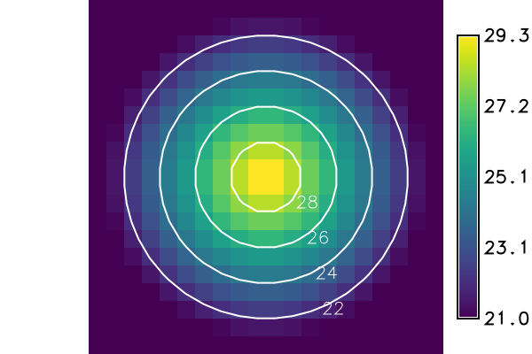

## DESCRIPTION

*t.rast.contour* computes the contour lines of each raster map registered in
a space time raster dataset and registers them as vector maps in a new space
time vector dataset. It runs *[r.contour](r.contour.md)* for every map, so the
contour lines are those of *r.contour*. Each new vector map gets the start and
end time of the raster map it was computed from. See the
[introduction to temporal data processing](temporalintro.md) for space time
datasets.

The option **input** names the space time raster dataset, the option
**output** the new space time vector dataset. The new dataset takes the
temporal type, the semantic type, the title and the description of the input
dataset. The option **where** takes an SQL condition on the registered maps
and selects the maps to process, for instance by their `start_time`; without
it, all maps are processed.

Either **levels** or **step** sets the contour levels:

- **levels** takes a list of levels, separated by commas. A level outside the
  values of a map gives no line in that map.
- **step** sets the distance between two levels. The levels are the
  multiples of **step** that lie within the smallest and the largest value of
  each map, so maps with different values get different levels; in the first
  example, **step** `2` gives the even numbers within the values of each map.
- **minlevel** and **maxlevel** limit the levels of a step. With
  **minlevel**, the levels start at **minlevel** and follow in steps of
  **step**, instead of being multiples of **step**. Only the levels from
  **minlevel** up to **maxlevel**, both included, that lie within the values
  of a map are used. **maxlevel** is a level only if it lies on this grid of
  levels. The limits apply to every map of the dataset: a map whose values lie
  wholly below **minlevel** or wholly above **maxlevel** gets no level.

If both **levels** and **step** are given, *r.contour* uses the list and
ignores the step. A level equal to the smallest value of a map gives no line.

The option **cut** leaves out the contour lines with fewer points than the
given number. The default `0` keeps all lines.

Each new vector map has an attribute table with the column `level`, the
contour level of its lines; *[t.vect.db.select](t.vect.db.select.md)* prints
these tables for the whole dataset. The flag **-t** creates the vector maps
without attribute tables.

The option **nprocs** sets the number of *r.contour* runs at the same time,
`1` by default. More than one run at a time works only with **-t**: without
it, *t.rast.contour* sets **nprocs** to `1` and warns, because the attribute
tables cannot be created in parallel.

The new vector maps are named after the option **basename**, followed by an
underscore and a suffix that the option **suffix** chooses:

- `gran` (the default) takes the start time of the raster map, cut to the
  granularity of the input dataset: `2026_07_01` in a dataset of days. A
  dataset of a single time instance has no granularity; `gran` then takes the
  full start time, as `time` does.
- `time` takes the full start time: `2026_07_01T00_00_00`.
- `num` numbers the selected maps from 1, with five digits: `00001`.
  `num%03` gives three digits: `001`.

In a dataset with relative time, each suffix gives the number, because a
relative time has no calendar date.

A raster map can give a vector map without lines, for instance when no level
lies within its values or when the map has no values. Such an empty vector map
is removed and not registered, unless the flag **-n** is given; then it is
registered as well.

## NOTES

*r.contour* computes each map in the current computational region. The
contour lines run between the centres of the cells, so a line that leaves the
region ends at the centre of the cell at its border, as the last example
shows. Null cells, also the cells outside a raster mask, count as cells
outside the region: a line ends at them in the same way. A raster mask on a
rectangle therefore gives the same lines as the region of that rectangle, as
the last example shows as well; only a closed line or a line with saddles at
its ends within about one cell of the border can differ (see *r.contour*).

If **where** selects no map, *t.rast.contour* warns that the space time raster
dataset is empty and creates no output dataset.

If neither **levels** nor **step** is given, *t.rast.contour* stops with the
error "Either `<levels>` or `<step>` option must be specified"; *r.contour*
refuses a **step** of `0` with "This step value is not allowed". In both cases
no dataset is created. An unknown **suffix** is refused before anything is
written, for instance with "Invalid suffix `<gram>`, use gran, time, num or
num%NN" for `suffix=gram`. An SQL error in **where** stops the tool with a
message that begins with "Invalid where condition".

An existing **output** dataset is replaced only with **--overwrite**; the
vector maps of the same names are then replaced as well.

The input dataset can be in another mapset of the project; the name with the
mapset (`input=tmax@PERMANENT`) selects it. The new vector maps and the new
dataset are always created in the current mapset, as the last example shows.

## EXAMPLES

<!-- markdownlint-disable MD046 -->

### Contour lines at a regular step

The dataset `tmax` holds the daily maximum air temperature of three hot days
in July over a city, on a region of 20 by 20 cells. In the countryside the
temperature is 21 degrees; towards the centre of the city at (10, 10), it
rises by 1 degree per cell. The expression
`sqrt((x() - 10)^2 + (y() - 10)^2)` is the distance of a cell centre from the
city centre. The peak at the centre grows from 24 degrees on the first day to
27 and 30 degrees. No cell centre lies exactly at (10, 10); the nearest ones
are 0.71 cells away, so the highest values of the maps are 23.29, 26.29 and
29.29. A contour line of the level L is a circle around the city centre with
the radius peak - L.

With **step** `2`, the levels are the even numbers between the smallest and
the largest value of each map:

- the first day (21 to 23.29) has one line, at 22 degrees;
- the second day (21 to 26.29) has three, at 22, 24 and 26 degrees;
- the third day (21 to 29.29) has four, at 22, 24, 26 and 28 degrees.

The first block computes the contour lines and lists the new vector maps with
their number of lines. The default suffix `gran` names the maps after the day.
The second block prints the levels from the attribute tables with
*t.vect.db.select*. The third block shows with *[t.info](t.info.md)* that the
new dataset `isotherms` has the time, the semantic type `max`, the title and
the description of the input dataset, and 1 + 3 + 4 = 8 lines. *r.contour*
writes 3D lines at the height of their level, so the top and the bottom of
the dataset are the highest and the lowest level, 28 and 22.

=== "Command line"

    ```sh
    g.region n=20 s=0 e=20 w=0 res=1
    r.mapcalc expression="tmax_1 = max(21, 24 - sqrt((x() - 10)^2 + (y() - 10)^2))"
    r.mapcalc expression="tmax_2 = max(21, 27 - sqrt((x() - 10)^2 + (y() - 10)^2))"
    r.mapcalc expression="tmax_3 = max(21, 30 - sqrt((x() - 10)^2 + (y() - 10)^2))"
    t.create output=tmax semantictype=max title="Maximum temperature" \
        description="Daily maximum air temperature in degrees Celsius"
    t.register -i input=tmax maps=tmax_1,tmax_2,tmax_3 \
        start=2026-07-01 increment="1 day"
    t.rast.contour input=tmax output=isotherms basename=isotherm step=2
    t.vect.list input=isotherms columns=name,start_time,end_time,lines
    ```

    ```text
    name|start_time|end_time|lines
    isotherm_2026_07_01|2026-07-01 00:00:00|2026-07-02 00:00:00|1
    isotherm_2026_07_02|2026-07-02 00:00:00|2026-07-03 00:00:00|3
    isotherm_2026_07_03|2026-07-03 00:00:00|2026-07-04 00:00:00|4
    ```

    ```sh
    t.vect.db.select input=isotherms columns=level
    ```

    ```text
    start_time|end_time|level
    2026-07-01 00:00:00|2026-07-02 00:00:00|22
    2026-07-02 00:00:00|2026-07-03 00:00:00|22
    2026-07-02 00:00:00|2026-07-03 00:00:00|24
    2026-07-02 00:00:00|2026-07-03 00:00:00|26
    2026-07-03 00:00:00|2026-07-04 00:00:00|22
    2026-07-03 00:00:00|2026-07-04 00:00:00|24
    2026-07-03 00:00:00|2026-07-04 00:00:00|26
    2026-07-03 00:00:00|2026-07-04 00:00:00|28
    ```

    ```sh
    t.info type=stvds input=isotherms
    ```

    ```text
     +-------------------- Space Time Vector Dataset -----------------------------+
     |                                                                            |
     +-------------------- Basic information -------------------------------------+
     | Id: ........................ isotherms@PERMANENT
     | Name: ...................... isotherms
     | Mapset: .................... PERMANENT
     | Creator: ................... user
     | Temporal type: ............. absolute
     | Creation time: ............. 2026-11-01 12:00:00
     | Modification time:.......... 2026-11-01 12:00:00
     | Semantic type:.............. max
     +-------------------- Absolute time -----------------------------------------+
     | Start time:................. 2026-07-01 00:00:00
     | End time:................... 2026-07-04 00:00:00
     | Granularity:................ 1 day
     | Temporal type of maps:...... interval
     +-------------------- Spatial extent ----------------------------------------+
     | North:...................... 17.984298617624916
     | South:...................... 2.0157013823750844
     | East:.. .................... 17.984298617624916
     | West:....................... 2.0157013823750844
     | Top:........................ 28.0
     | Bottom:..................... 22.0
     +-------------------- Metadata information ----------------------------------+
     | Vector register table:...... vector_map_register_00000000000000000000000000000000
     | Number of points ........... 0
     | Number of lines ............ 8
     | Number of boundaries ....... 0
     | Number of centroids ........ 0
     | Number of faces ............ 0
     | Number of kernels .......... 0
     | Number of primitives ....... 8
     | Number of nodes ............ 8
     | Number of areas ............ 0
     | Number of islands .......... 0
     | Number of holes ............ 0
     | Number of volumes .......... 0
     | Number of registered maps:.. 3
     |
     | Title:
     | Maximum temperature
     | Description:
     | Daily maximum air temperature in degrees Celsius
     | Command history:
     | # 2026-11-01 12:00:00 
     | t.rast.contour input="tmax" output="isotherms"
     |     basename="isotherm" step="2"
     | 
     +----------------------------------------------------------------------------+
    ```

=== "Python (grass.tools)"

    ```python
    from grass.tools import Tools

    tools = Tools()
    tools.g_region(n=20, s=0, e=20, w=0, res=1)
    for day, peak in ((1, 24), (2, 27), (3, 30)):
        tools.r_mapcalc(
            expression=f"tmax_{day} = max(21, {peak} - sqrt((x() - 10)^2 + (y() - 10)^2))"
        )
    tools.t_create(
        output="tmax",
        semantictype="max",
        title="Maximum temperature",
        description="Daily maximum air temperature in degrees Celsius",
    )
    tools.t_register(
        input="tmax",
        maps="tmax_1,tmax_2,tmax_3",
        start="2026-07-01",
        increment="1 day",
        flags="i",
    )
    tools.t_rast_contour(input="tmax", output="isotherms", basename="isotherm", step=2)
    result = tools.t_vect_list(input="isotherms", columns="name,start_time,end_time,lines")
    print(result.text)
    ```

    ```text
    name|start_time|end_time|lines
    isotherm_2026_07_01|2026-07-01 00:00:00|2026-07-02 00:00:00|1
    isotherm_2026_07_02|2026-07-02 00:00:00|2026-07-03 00:00:00|3
    isotherm_2026_07_03|2026-07-03 00:00:00|2026-07-04 00:00:00|4
    ```

    ```python
    print(tools.t_vect_db_select(input="isotherms", columns="level").text)
    ```

    ```text
    start_time|end_time|level
    2026-07-01 00:00:00|2026-07-02 00:00:00|22
    2026-07-02 00:00:00|2026-07-03 00:00:00|22
    2026-07-02 00:00:00|2026-07-03 00:00:00|24
    2026-07-02 00:00:00|2026-07-03 00:00:00|26
    2026-07-03 00:00:00|2026-07-04 00:00:00|22
    2026-07-03 00:00:00|2026-07-04 00:00:00|24
    2026-07-03 00:00:00|2026-07-04 00:00:00|26
    2026-07-03 00:00:00|2026-07-04 00:00:00|28
    ```

    ```python
    print(tools.t_info(type="stvds", input="isotherms").stdout, end="")
    ```

    ```text
     +-------------------- Space Time Vector Dataset -----------------------------+
     |                                                                            |
     +-------------------- Basic information -------------------------------------+
     | Id: ........................ isotherms@PERMANENT
     | Name: ...................... isotherms
     | Mapset: .................... PERMANENT
     | Creator: ................... user
     | Temporal type: ............. absolute
     | Creation time: ............. 2026-11-01 12:00:00
     | Modification time:.......... 2026-11-01 12:00:00
     | Semantic type:.............. max
     +-------------------- Absolute time -----------------------------------------+
     | Start time:................. 2026-07-01 00:00:00
     | End time:................... 2026-07-04 00:00:00
     | Granularity:................ 1 day
     | Temporal type of maps:...... interval
     +-------------------- Spatial extent ----------------------------------------+
     | North:...................... 17.984298617624916
     | South:...................... 2.0157013823750844
     | East:.. .................... 17.984298617624916
     | West:....................... 2.0157013823750844
     | Top:........................ 28.0
     | Bottom:..................... 22.0
     +-------------------- Metadata information ----------------------------------+
     | Vector register table:...... vector_map_register_00000000000000000000000000000000
     | Number of points ........... 0
     | Number of lines ............ 8
     | Number of boundaries ....... 0
     | Number of centroids ........ 0
     | Number of faces ............ 0
     | Number of kernels .......... 0
     | Number of primitives ....... 8
     | Number of nodes ............ 8
     | Number of areas ............ 0
     | Number of islands .......... 0
     | Number of holes ............ 0
     | Number of volumes .......... 0
     | Number of registered maps:.. 3
     |
     | Title:
     | Maximum temperature
     | Description:
     | Daily maximum air temperature in degrees Celsius
     | Command history:
     | # 2026-11-01 12:00:00 
     | t.rast.contour input="tmax" output="isotherms"
     |     basename="isotherm" step="2"
     | 
     +----------------------------------------------------------------------------+
    ```

### Draw the contour lines over the raster map

The figure shows the map of the third day with its contour lines and their
levels as labels. *d.rast* draws the raster map, *d.vect* the contour lines
with the column `level` of the attribute table as label, and *d.legend* the
colour scale of the temperature, labelled every 2 degrees (**label_step**)
without decimals (**digits**).

=== "Command line"

    ```sh
    d.mon start=cairo output=t_rast_contour_lines.png width=600 height=400
    d.rast map=tmax_3
    d.vect map=isotherm_2026_07_03 color=white width=2 \
        attribute_column=level label_color=white label_size=16
    d.legend raster=tmax_3 at=10,90,86,90 label_step=2 digits=0
    d.mon stop=cairo
    ```

=== "Python (grass.tools)"

    ```python
    tools.d_mon(start="cairo", output="t_rast_contour_lines.png", width=600, height=400)
    tools.d_rast(map="tmax_3")
    tools.d_vect(
        map="isotherm_2026_07_03",
        color="white",
        width=2,
        attribute_column="level",
        label_color="white",
        label_size=16,
    )
    tools.d_legend(raster="tmax_3", at=[10, 90, 86, 90], label_step=2, digits=0)
    tools.d_mon(stop="cairo")
    ```



*Figure: Contour lines at 22, 24, 26 and 28 degrees, labelled with their
level, over the maximum temperature of the third day, `tmax_3`.*

### Contour lines at chosen levels

With **levels** `25,28`, the second day (up to 26.29 degrees) has one line, at
25 degrees, and the third day two, at 25 and 28 degrees. The first day stays
below 25 degrees, so its vector map has no line: *t.rast.contour* removes it
and registers two maps.

In the second block, the flag **-n** keeps the empty map of the first day, and
**--overwrite** replaces the dataset `heat` of the first block together with
its vector maps.

=== "Command line"

    ```sh
    t.rast.contour input=tmax output=heat basename=heat levels=25,28
    t.vect.list input=heat columns=name,start_time,lines
    ```

    ```text
    name|start_time|lines
    heat_2026_07_02|2026-07-02 00:00:00|1
    heat_2026_07_03|2026-07-03 00:00:00|2
    ```

    ```sh
    t.rast.contour -n input=tmax output=heat basename=heat levels=25,28 \
        --overwrite
    t.vect.list input=heat columns=name,start_time,lines
    ```

    ```text
    name|start_time|lines
    heat_2026_07_01|2026-07-01 00:00:00|0
    heat_2026_07_02|2026-07-02 00:00:00|1
    heat_2026_07_03|2026-07-03 00:00:00|2
    ```

=== "Python (grass.tools)"

    ```python
    tools.t_rast_contour(input="tmax", output="heat", basename="heat", levels=[25, 28])
    print(tools.t_vect_list(input="heat", columns="name,start_time,lines").text)
    ```

    ```text
    name|start_time|lines
    heat_2026_07_02|2026-07-02 00:00:00|1
    heat_2026_07_03|2026-07-03 00:00:00|2
    ```

    ```python
    tools.t_rast_contour(
        input="tmax",
        output="heat",
        basename="heat",
        levels=[25, 28],
        flags="n",
        overwrite=True,
    )
    print(tools.t_vect_list(input="heat", columns="name,start_time,lines").text)
    ```

    ```text
    name|start_time|lines
    heat_2026_07_01|2026-07-01 00:00:00|0
    heat_2026_07_02|2026-07-02 00:00:00|1
    heat_2026_07_03|2026-07-03 00:00:00|2
    ```

### Contour lines in a range of levels

**minlevel** and **maxlevel** limit the levels of a step. With **step** `1`,
**minlevel** `22` and **maxlevel** `24`, the second and the third day have
lines at 22, 23 and 24 degrees. The first day reaches only 23.29 degrees, so
its levels end at 23.

The second block shows that **maxlevel** is a limit, not a level, when it does
not lie on the grid of **minlevel** and **step**: with **maxlevel** `23.5`,
the second and the third day have lines at 22 and 23 degrees. The condition
in **where** leaves out the first day.

The third and the fourth block show maps whose values lie outside the limits;
such a map gets no level and so no line:

- With **minlevel** `24` and **maxlevel** `26`, the values of the first day
  (21 to 23.29) lie wholly below **minlevel**. Its vector map is empty and is
  not registered; the second and the third day have three lines each, at 24,
  25 and 26 degrees.
- With **minlevel** `18` and **maxlevel** `20`, the values of every day lie
  wholly above **maxlevel**, so no day has a line. With **-n**, the three
  empty vector maps are registered all the same.

=== "Command line"

    ```sh
    t.rast.contour input=tmax output=degrees basename=degrees \
        step=1 minlevel=22 maxlevel=24
    t.vect.db.select input=degrees columns=level
    ```

    ```text
    start_time|end_time|level
    2026-07-01 00:00:00|2026-07-02 00:00:00|22
    2026-07-01 00:00:00|2026-07-02 00:00:00|23
    2026-07-02 00:00:00|2026-07-03 00:00:00|22
    2026-07-02 00:00:00|2026-07-03 00:00:00|23
    2026-07-02 00:00:00|2026-07-03 00:00:00|24
    2026-07-03 00:00:00|2026-07-04 00:00:00|22
    2026-07-03 00:00:00|2026-07-04 00:00:00|23
    2026-07-03 00:00:00|2026-07-04 00:00:00|24
    ```

    ```sh
    t.rast.contour input=tmax output=half_top basename=half_top \
        step=1 minlevel=22 maxlevel=23.5 where="start_time >= '2026-07-02'"
    t.vect.db.select input=half_top columns=level
    ```

    ```text
    start_time|end_time|level
    2026-07-02 00:00:00|2026-07-03 00:00:00|22
    2026-07-02 00:00:00|2026-07-03 00:00:00|23
    2026-07-03 00:00:00|2026-07-04 00:00:00|22
    2026-07-03 00:00:00|2026-07-04 00:00:00|23
    ```

    ```sh
    t.rast.contour input=tmax output=below basename=below \
        step=1 minlevel=24 maxlevel=26
    t.vect.list input=below columns=name,lines
    ```

    ```text
    name|lines
    below_2026_07_02|3
    below_2026_07_03|3
    ```

    ```sh
    t.rast.contour -n input=tmax output=above basename=above \
        step=1 minlevel=18 maxlevel=20
    t.vect.list input=above columns=name,lines
    ```

    ```text
    name|lines
    above_2026_07_01|0
    above_2026_07_02|0
    above_2026_07_03|0
    ```

=== "Python (grass.tools)"

    ```python
    tools.t_rast_contour(
        input="tmax",
        output="degrees",
        basename="degrees",
        step=1,
        minlevel=22,
        maxlevel=24,
    )
    print(tools.t_vect_db_select(input="degrees", columns="level").text)
    ```

    ```text
    start_time|end_time|level
    2026-07-01 00:00:00|2026-07-02 00:00:00|22
    2026-07-01 00:00:00|2026-07-02 00:00:00|23
    2026-07-02 00:00:00|2026-07-03 00:00:00|22
    2026-07-02 00:00:00|2026-07-03 00:00:00|23
    2026-07-02 00:00:00|2026-07-03 00:00:00|24
    2026-07-03 00:00:00|2026-07-04 00:00:00|22
    2026-07-03 00:00:00|2026-07-04 00:00:00|23
    2026-07-03 00:00:00|2026-07-04 00:00:00|24
    ```

    ```python
    tools.t_rast_contour(
        input="tmax",
        output="half_top",
        basename="half_top",
        step=1,
        minlevel=22,
        maxlevel=23.5,
        where="start_time >= '2026-07-02'",
    )
    print(tools.t_vect_db_select(input="half_top", columns="level").text)
    ```

    ```text
    start_time|end_time|level
    2026-07-02 00:00:00|2026-07-03 00:00:00|22
    2026-07-02 00:00:00|2026-07-03 00:00:00|23
    2026-07-03 00:00:00|2026-07-04 00:00:00|22
    2026-07-03 00:00:00|2026-07-04 00:00:00|23
    ```

    ```python
    tools.t_rast_contour(
        input="tmax", output="below", basename="below", step=1, minlevel=24, maxlevel=26
    )
    print(tools.t_vect_list(input="below", columns="name,lines").text)
    ```

    ```text
    name|lines
    below_2026_07_02|3
    below_2026_07_03|3
    ```

    ```python
    tools.t_rast_contour(
        input="tmax",
        output="above",
        basename="above",
        step=1,
        minlevel=18,
        maxlevel=20,
        flags="n",
    )
    print(tools.t_vect_list(input="above", columns="name,lines").text)
    ```

    ```text
    name|lines
    above_2026_07_01|0
    above_2026_07_02|0
    above_2026_07_03|0
    ```

### Leave out short contour lines

The first block prints the line at 26 degrees of the second day, from the
dataset `isotherms` of the first example. *[v.out.ascii](v.out.ascii.md)*
starts a line with `L`, the number of its points and the number of its
categories: the small circle around the centre has only 9 points.

With **cut** `10`, the lines with fewer than 10 points are left out. The second
day keeps its two other lines, at 22 and 24 degrees; the first and the third
day keep all their lines, because none of them has fewer than 10 points.

=== "Command line"

    ```sh
    v.out.ascii input=isotherm_2026_07_02 format=standard \
        where="level = 26" | grep "^L"
    ```

    ```text
    L  9 1
    ```

    ```sh
    t.rast.contour input=tmax output=long basename=long step=2 cut=10
    t.vect.list input=long columns=name,lines
    ```

    ```text
    name|lines
    long_2026_07_01|1
    long_2026_07_02|2
    long_2026_07_03|4
    ```

=== "Python (grass.tools)"

    ```python
    result = tools.v_out_ascii(
        input="isotherm_2026_07_02", format="standard", where="level = 26"
    )
    for line in result.text.splitlines():
        if line.startswith("L"):
            print(line)
    ```

    ```text
    L  9 1
    ```

    ```python
    tools.t_rast_contour(input="tmax", output="long", basename="long", step=2, cut=10)
    print(tools.t_vect_list(input="long", columns="name,lines").text)
    ```

    ```text
    name|lines
    long_2026_07_01|1
    long_2026_07_02|2
    long_2026_07_03|4
    ```

### Choose the names of the new maps

The option **suffix** chooses how the new maps are named after **basename**:

1. `time` takes the full start time of each raster map.
2. `num%03` numbers the maps with three digits. The condition in **where**
   selects the second and the third day, and the numbers count the selected
   maps from 1.
3. In a dataset with relative time, the suffix is always a number. The
   dataset `forecast` holds a forecast of the second and the third day, as
   days 1 and 2 after the start of a model run; the default suffix `gran`
   numbers the maps.

=== "Command line"

    ```sh
    t.rast.contour input=tmax output=timed basename=timed step=2 suffix=time
    t.vect.list input=timed columns=name
    ```

    ```text
    name
    timed_2026_07_01T00_00_00
    timed_2026_07_02T00_00_00
    timed_2026_07_03T00_00_00
    ```

    ```sh
    t.rast.contour input=tmax output=hot_days basename=hot_day step=2 \
        suffix=num%03 where="start_time >= '2026-07-02'"
    t.vect.list input=hot_days columns=name,start_time
    ```

    ```text
    name|start_time
    hot_day_001|2026-07-02 00:00:00
    hot_day_002|2026-07-03 00:00:00
    ```

    ```sh
    r.mapcalc expression="forecast_1 = tmax_2"
    r.mapcalc expression="forecast_2 = tmax_3"
    t.create output=forecast temporaltype=relative title="Forecast" \
        description="Forecast of the daily maximum air temperature"
    t.register -i input=forecast maps=forecast_1,forecast_2 \
        start=1 increment=1 unit=days
    t.rast.contour input=forecast output=forecast_isotherms \
        basename=forecast_isotherm step=2
    t.vect.list input=forecast_isotherms columns=name,start_time,end_time,lines
    ```

    ```text
    name|start_time|end_time|lines
    forecast_isotherm_00001|1|2|3
    forecast_isotherm_00002|2|3|4
    ```

=== "Python (grass.tools)"

    ```python
    tools.t_rast_contour(
        input="tmax", output="timed", basename="timed", step=2, suffix="time"
    )
    print(tools.t_vect_list(input="timed", columns="name").text)
    ```

    ```text
    name
    timed_2026_07_01T00_00_00
    timed_2026_07_02T00_00_00
    timed_2026_07_03T00_00_00
    ```

    ```python
    tools.t_rast_contour(
        input="tmax",
        output="hot_days",
        basename="hot_day",
        step=2,
        suffix="num%03",
        where="start_time >= '2026-07-02'",
    )
    print(tools.t_vect_list(input="hot_days", columns="name,start_time").text)
    ```

    ```text
    name|start_time
    hot_day_001|2026-07-02 00:00:00
    hot_day_002|2026-07-03 00:00:00
    ```

    ```python
    tools.r_mapcalc(expression="forecast_1 = tmax_2")
    tools.r_mapcalc(expression="forecast_2 = tmax_3")
    tools.t_create(
        output="forecast",
        temporaltype="relative",
        title="Forecast",
        description="Forecast of the daily maximum air temperature",
    )
    tools.t_register(
        input="forecast",
        maps="forecast_1,forecast_2",
        start=1,
        increment=1,
        unit="days",
        flags="i",
    )
    tools.t_rast_contour(
        input="forecast",
        output="forecast_isotherms",
        basename="forecast_isotherm",
        step=2,
    )
    result = tools.t_vect_list(
        input="forecast_isotherms", columns="name,start_time,end_time,lines"
    )
    print(result.text)
    ```

    ```text
    name|start_time|end_time|lines
    forecast_isotherm_00001|1|2|3
    forecast_isotherm_00002|2|3|4
    ```

### Compute the contour lines in parallel

With the flag **-t**, the vector maps get no attribute table, and **nprocs**
can run several *r.contour* processes at the same time; here three, one for
each map. The lines are the same as in the first example. *v.info* shows that
the map of the third day is linked to no attribute table.

=== "Command line"

    ```sh
    t.rast.contour -t input=tmax output=quick basename=quick step=2 nprocs=3
    t.vect.list input=quick columns=name,lines
    v.info -e map=quick_2026_07_03 | grep num_dblinks
    ```

    ```text
    name|lines
    quick_2026_07_01|1
    quick_2026_07_02|3
    quick_2026_07_03|4
    num_dblinks=0
    ```

=== "Python (grass.tools)"

    ```python
    tools.t_rast_contour(
        input="tmax", output="quick", basename="quick", step=2, nprocs=3, flags="t"
    )
    print(tools.t_vect_list(input="quick", columns="name,lines").text)
    info = tools.v_info(map="quick_2026_07_03", flags="e").keyval
    print(f"num_dblinks={info['num_dblinks']}")
    ```

    ```text
    name|lines
    quick_2026_07_01|1
    quick_2026_07_02|3
    quick_2026_07_03|4
    num_dblinks=0
    ```

### Use a dataset of another mapset

The example creates the mapset `analysis` and switches to it. The dataset
`tmax` stays in the mapset `PERMANENT` and is named with its mapset; the new
dataset `west` and its vector maps are created in `analysis`, as the column
`id` shows.

The region of the new mapset is set to the western half of the maps, so the
circles become half circles that end at x = 9.5, the centre of the eastern
cells of the region. A closed circle has one node, as the 8 lines with 8
nodes of the first example show; a half circle has two, one at each end, so
the third day has four lines with eight nodes.

The second block restricts the area to the same western half with a raster
mask instead, on the full region. The cells outside the mask are null cells,
and the lines end at them as at the border of the region: the half circles
have the same lines, nodes and eastern edge as with the region.

=== "Command line"

    ```sh
    g.mapset -c mapset=analysis
    g.region n=20 s=0 e=10 w=0 res=1
    t.rast.contour input=tmax@PERMANENT output=west basename=west step=2
    t.vect.list input=west columns=id,lines,nodes,east
    ```

    ```text
    id|lines|nodes|east
    west_2026_07_01@analysis|1|2|9.5
    west_2026_07_02@analysis|3|6|9.5
    west_2026_07_03@analysis|4|8|9.5
    ```

    ```sh
    g.region n=20 s=0 e=20 w=0 res=1
    r.mapcalc expression="west_half = if(x() < 10, 1, null())"
    r.mask raster=west_half
    t.rast.contour input=tmax@PERMANENT output=masked basename=masked step=2
    r.mask -r
    t.vect.list input=masked columns=id,lines,nodes,east
    ```

    ```text
    id|lines|nodes|east
    masked_2026_07_01@analysis|1|2|9.5
    masked_2026_07_02@analysis|3|6|9.5
    masked_2026_07_03@analysis|4|8|9.5
    ```

=== "Python (grass.tools)"

    ```python
    tools.g_mapset(mapset="analysis", flags="c")
    tools.g_region(n=20, s=0, e=10, w=0, res=1)
    tools.t_rast_contour(input="tmax@PERMANENT", output="west", basename="west", step=2)
    print(tools.t_vect_list(input="west", columns="id,lines,nodes,east").text)
    ```

    ```text
    id|lines|nodes|east
    west_2026_07_01@analysis|1|2|9.5
    west_2026_07_02@analysis|3|6|9.5
    west_2026_07_03@analysis|4|8|9.5
    ```

    ```python
    tools.g_region(n=20, s=0, e=20, w=0, res=1)
    tools.r_mapcalc(expression="west_half = if(x() < 10, 1, null())")
    tools.r_mask(raster="west_half")
    tools.t_rast_contour(input="tmax@PERMANENT", output="masked", basename="masked", step=2)
    tools.r_mask(flags="r")
    print(tools.t_vect_list(input="masked", columns="id,lines,nodes,east").text)
    ```

    ```text
    id|lines|nodes|east
    masked_2026_07_01@analysis|1|2|9.5
    masked_2026_07_02@analysis|3|6|9.5
    masked_2026_07_03@analysis|4|8|9.5
    ```

<!-- markdownlint-enable MD046 -->

## SEE ALSO

*[d.legend](d.legend.md), [d.rast](d.rast.md), [d.vect](d.vect.md),
[g.mapset](g.mapset.md), [g.region](g.region.md),
[r.contour](r.contour.md), [t.create](t.create.md), [t.info](t.info.md),
[t.rast.to.vect](t.rast.to.vect.md), [t.register](t.register.md),
[t.vect.db.select](t.vect.db.select.md), [t.vect.list](t.vect.list.md),
[v.info](v.info.md), [v.out.ascii](v.out.ascii.md),
[temporal data processing](temporalintro.md)*

## AUTHOR

Sören Gebbert, Geoinformatikbüro Dassau
